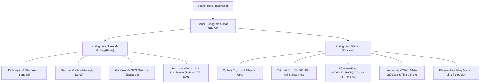
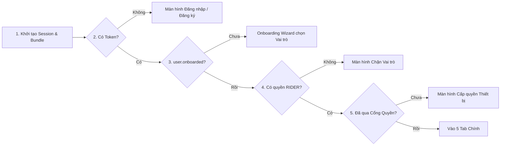
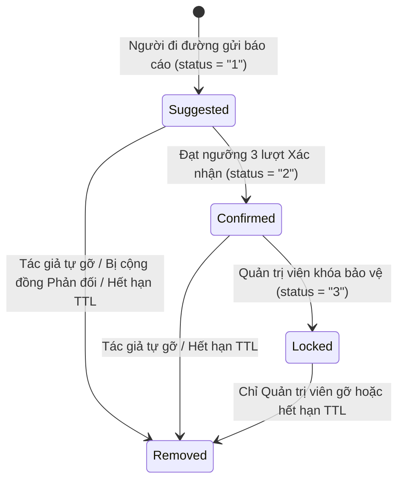
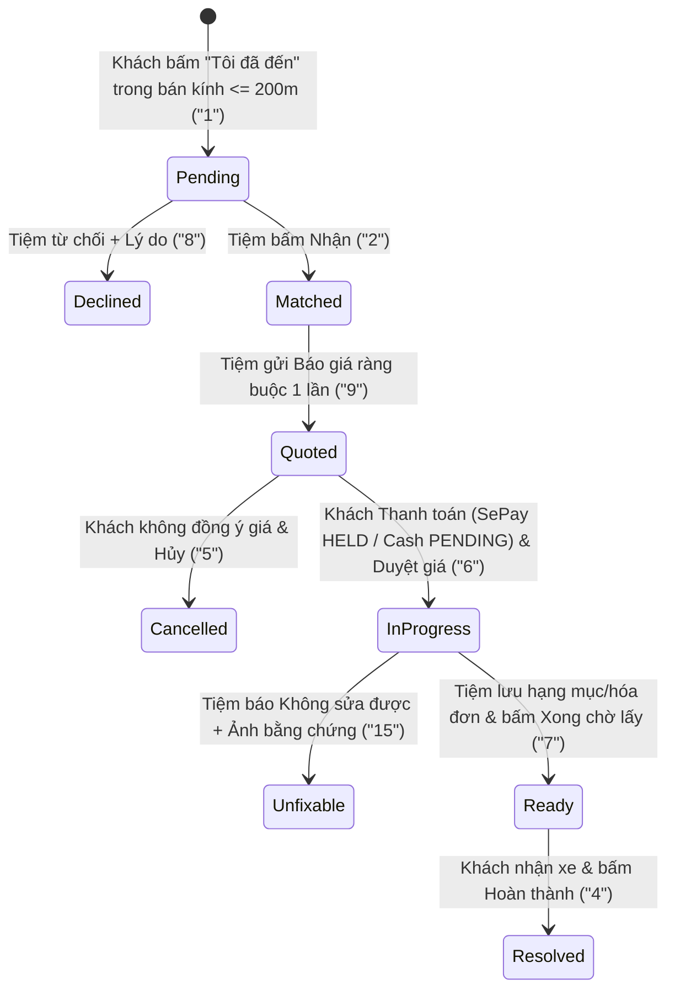
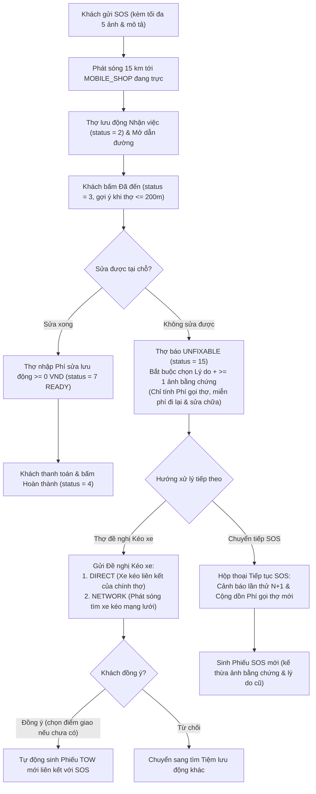

# Tài liệu Đặc tả Nghiệp vụ Hệ thống — RoadAssist Mobile

**RoadAssist** là nền tảng di động kết hợp **định tuyến thông minh theo kích thước xe & né ngập/sự cố**, **cảnh báo giao thông cộng đồng theo cơ chế đồng thuận**, và **sàn điều phối cứu hộ đường bộ đa phương thức** (Tiệm sửa xe cố định, Thợ sửa lưu động SOS, Xe cứu hộ kéo xe) tích hợp **thanh toán tạm giữ (Escrow) qua SePay QR & Tiền mặt**.

> [!NOTE]
> Tài liệu này được trích xuất trực tiếp từ toàn bộ mã nguồn của repository `ROADASSISTAPP_MOBILE` (phiên bản `v0.2.1`), phản ánh chính xác 100% quy tắc kiểm tra dữ liệu, máy trạng thái, ngưỡng khoảng cách/thời gian và hợp đồng API đang vận hành.

---

## 1. Tổng quan Kiến trúc Nghiệp vụ

Hệ thống xoay quanh một ứng dụng duy nhất phục vụ đồng thời cả **Người đi đường (Rider)** và **Đối tác cứu hộ (Provider)** thông qua cơ chế chuyển đổi không gian làm việc (Workspace) linh hoạt.



### Cấu trúc Điều hướng Chính
- **5 Tab chính** ([Tabs.tsx](file:///Users/it_picare/it_develop/wdp301/ROADASSISTAPP_MOBILE/src/navigation/Tabs.tsx)):
  1. **Lộ trình (`Route`)**: Tìm kiếm địa điểm, lập lộ trình đa điểm dừng, né vùng ngập/sự cố và cảnh báo hẻm hẹp theo chiều rộng xe ([RouteScreen.tsx](file:///Users/it_picare/it_develop/wdp301/ROADASSISTAPP_MOBILE/src/screens/RouteScreen.tsx)).
  2. **Cảnh báo (`Hazards`)**: Quản lý báo cáo của tôi & sự cố trong bán kính `2 km`, bình chọn xác nhận/phản đối ([HazardScreen.tsx](file:///Users/it_picare/it_develop/wdp301/ROADASSISTAPP_MOBILE/src/screens/HazardScreen.tsx)).
  3. **Cứu hộ (`Assist`)**: Trung tâm gọi cứu hộ, duyệt tiệm sửa xe, bảng nhận việc của đối tác và lịch sử hồ sơ cứu hộ; hiển thị huy hiệu đỏ đếm số hóa đơn chưa thanh toán ([AssistScreen.tsx](file:///Users/it_picare/it_develop/wdp301/ROADASSISTAPP_MOBILE/src/screens/AssistScreen.tsx)).
  4. **Xe của tôi (`Vehicle`)**: Quản lý danh sách hồ sơ xe, kích thước và cấu hình tải trọng ([VehicleScreen.tsx](file:///Users/it_picare/it_develop/wdp301/ROADASSISTAPP_MOBILE/src/screens/VehicleScreen.tsx)).
  5. **Thêm (`More`)**: Hồ sơ cá nhân, điểm thưởng uy tín, công tắc trực ca (`Duty`), Hóa đơn/Thanh toán, Cài đặt, Quyền thiết bị, Chẩn đoán và Cập nhật ứng dụng ([MoreScreen.tsx](file:///Users/it_picare/it_develop/wdp301/ROADASSISTAPP_MOBILE/src/screens/MoreScreen.tsx)).
- **Màn hình toàn cục trên Root Stack** ([App.tsx](file:///Users/it_picare/it_develop/wdp301/ROADASSISTAPP_MOBILE/App.tsx), [ref.ts](file:///Users/it_picare/it_develop/wdp301/ROADASSISTAPP_MOBILE/src/navigation/ref.ts)): `Navigation` (Dẫn đường toàn màn hình, khóa vuốt thoát), `Settings`, `Permissions`, `Providers`, `Bills`, `BillDetail`, `Payments`, `About`, `Diagnostics`.

---

## 2. Tác nhân, Phân quyền & Chuỗi Cổng Truy cập

### 2.1 Mô hình Vai trò 2 Lớp
Hệ thống tách biệt rõ **Giấy phép Người dùng (`User Services`)** và **Hồ sơ Đơn vị Cung cấp (`Provider Records`)** ([users.ts](file:///Users/it_picare/it_develop/wdp301/ROADASSISTAPP_MOBILE/src/api/users.ts), [providers.ts](file:///Users/it_picare/it_develop/wdp301/ROADASSISTAPP_MOBILE/src/api/providers.ts)):

| Tác nhân | Mã định danh | Bản chất dữ liệu | Quyền hạn & Đặc điểm nghiệp vụ |
|---|---|---|---|
| **Người đi đường** | `RIDER` | Giấy phép gốc trong `user.services` | **Bắt buộc cho mọi tài khoản di động.** Được lập lộ trình, báo sự cố, thêm xe, gọi cứu hộ, thanh toán hóa đơn. |
| **Tiệm sửa xe cố định** | `SHOP` | Bản ghi `Provider` (`kind = "SHOP"`) | Nhận khách vãng lai (`WALK_IN`) và làm điểm hạ xe cho cuốc kéo (`TOW`). Gửi báo giá sơ bộ, báo giá sửa chữa chính thức và quản lý bàn thợ. |
| **Tiệm sửa lưu động** | `MOBILE_SHOP` | Bản ghi `Provider` (`kind = "MOBILE_SHOP"`) | Thợ cơ động đi xe máy hoặc ô tô, nhận cuộc gọi cấp cứu `SOS` trong bán kính `15 km`, sửa tại chỗ hoặc chuyển giao xe kéo. |
| **Tài xế xe cứu hộ** | `TOW` | Bản ghi `Provider` (`kind = "TOW"`) | Vận hành xe cứu hộ (`CAR`), cần Admin xét duyệt biển số, nhận cuốc kéo `TOW` trực tiếp hoặc từ sàn chung `15 km`. |
| **Quản trị viên** | `role === "1"` | Trường `user.role` | Hiển thị huy hiệu **Quản trị** trên hồ sơ; duyệt giấy phép `TOW`, khóa cảnh báo sự cố (`Locked`), phân xử khiếu nại và chạy đợt chi trả (`PayoutBatch`). (Các tác vụ quản trị vận hành trên Web/BE). |

> [!IMPORTANT]
> Tài khoản chỉ có quyền Admin/Web mà **không có** `"RIDER"` trong `user.services` sẽ bị chặn tại cổng kiểm tra vai trò trên ứng dụng di động với thông báo *"Vai trò này chưa hỗ trợ trên di động"*.

### 2.2 Chuỗi 5 Cổng Kiểm soát Tuần tự khi Khởi động
Trước khi vào được giao diện 5 Tab chính, người dùng phải đi qua 5 cổng kiểm tra nghiêm ngặt trong [Tabs.tsx](file:///Users/it_picare/it_develop/wdp301/ROADASSISTAPP_MOBILE/src/navigation/Tabs.tsx):



1. **Đăng ký & Đăng nhập** ([LoginScreen.tsx](file:///Users/it_picare/it_develop/wdp301/ROADASSISTAPP_MOBILE/src/screens/LoginScreen.tsx), [AuthContext.tsx](file:///Users/it_picare/it_develop/wdp301/ROADASSISTAPP_MOBILE/src/context/AuthContext.tsx)):
   - Đăng ký yêu cầu: `email`, `password` (`>= 6` ký tự), `phone` (bắt buộc) và `displayName` (tùy chọn). Gọi `POST /users/register` tạo tài khoản rồi đăng nhập Firebase Auth lấy Bearer ID Token lưu vào `SecureStore` (`roadassist.session`).
   - **Cơ chế tự làm mới Token & Cưỡng chế Đăng xuất** ([client.ts](file:///Users/it_picare/it_develop/wdp301/ROADASSISTAPP_MOBILE/src/api/client.ts)): Mọi request timeout sau `12 giây` và tự động gộp các request trùng lặp đang bay (in-flight deduplication). Nếu gặp HTTP `401`, client tự gọi Firebase làm mới token và thử lại 1 lần; nếu vẫn `401` hoặc gặp **`403` với thông điệp `"User is inactive"`** (tài khoản bị khóa), ứng dụng lập tức xóa phiên, xóa cache và đăng xuất.
2. **Onboarding Đa bước** ([OnboardingScreen.tsx](file:///Users/it_picare/it_develop/wdp301/ROADASSISTAPP_MOBILE/src/screens/OnboardingScreen.tsx)):
   - Bước 1 chọn vai trò (`RIDER` luôn khóa bật; có thể chọn thêm `MOBILE_SHOP`, `SHOP`, `TOW`). Có nút **Để sau** (chỉ kích hoạt `RIDER`).
   - Nếu chọn vai trò đối tác nào chưa đăng ký, thuật sĩ dẫn qua từng bước nhập hồ sơ chi tiết cho đúng vai trò đó rồi gọi tuần tự `PUT /users/onboard` và `POST /providers`. Có thể mở lại bất cứ lúc nào tại **Thêm › Cài đặt › Dịch vụ**.
3. **Cổng Quyền Thiết bị lần đầu** ([PermissionGateScreen.tsx](file:///Users/it_picare/it_develop/wdp301/ROADASSISTAPP_MOBILE/src/screens/PermissionGateScreen.tsx), [permissions.ts](file:///Users/it_picare/it_develop/wdp301/ROADASSISTAPP_MOBILE/src/services/permissions.ts)):
   - Để bấm nút **Xong**, người dùng bắt buộc cấp quyền **Thông báo** và (riêng trên Android) **Vị trí nền (Luôn luôn)**. Quyền Máy ảnh, Thư viện ảnh và Pin không giới hạn là tùy chọn. Người dùng vẫn có thể bấm **Bỏ qua** để vào app (lưu cờ `roadassist.permGate = "done"`).

---

## 3. Hồ sơ Phương tiện, Nhà cung cấp & Quản lý Trực ca

### 3.1 Hồ sơ Phương tiện (`VehicleProfile`)
Quản lý tại [VehicleScreen.tsx](file:///Users/it_picare/it_develop/wdp301/ROADASSISTAPP_MOBILE/src/screens/VehicleScreen.tsx) và [vehicles.ts](file:///Users/it_picare/it_develop/wdp301/ROADASSISTAPP_MOBILE/src/api/vehicles.ts):
- **2 Phân loại chuẩn**:
  - `BIKE` (Xe máy — gom cả các mã cũ `SCOOTER`, `CUB`, `MANUAL`): Kích thước mặc định rộng `0.7 m` × cao `1.1 m`.
  - `CAR` (Ô tô — gom cả `VAN`, `TRUCK`): Kích thước mặc định rộng `1.9 m` × cao `1.5 m`.
- **Ràng buộc kích thước khi tạo mới**: Chiều rộng phải nằm trong đoạn **`[0.3 m, 3.0 m]`**, chiều cao trong đoạn **`[0.5 m, 3.0 m]`**. Ngay sau khi tạo xe (`POST /vehicleProfiles`), hệ thống tự động gắn cấu hình tải trọng mặc định là `SOLO` (`POST /vehicleProfiles/rideConfig`).
- **Cấu hình Chuyến đi (`RideConfig`)**: Cho phép chọn `SOLO` (Đi một mình), `PASSENGER` (Chở người) hoặc `CARGO` (Chở hàng) kèm chiều rộng/chiều cao ước tính thực tế (`> 0 m`).
- **Xe đang dùng (`activeVehicle`)**: Tại mỗi thời điểm chỉ có tối đa 1 xe được đặt làm `activeVehicle` (`PUT /users/activeVehicle`), quyết định thông số tìm đường và loại cứu hộ được phép gọi.
- **Ràng buộc Xóa xe & Thu hồi Giấy phép Đối tác**: Nếu một hồ sơ xe đang liên kết với giấy phép `TOW` hoặc `MOBILE_SHOP` (`providerLinks.length > 0`), hộp thoại xóa xe sẽ cảnh báo đỏ: **xóa xe sẽ thu hồi toàn bộ các giấy phép nhà cung cấp đang gắn với xe đó** (`revokedProviders`). Ngược lại, nếu chỉ thu hồi giấy phép tại màn hình Nhà cung cấp (`POST /providers/revoke`), hồ sơ xe vẫn được giữ nguyên.

### 3.2 Quy tắc Đăng ký & Ràng buộc của 3 Loại Nhà cung cấp
Quản lý tại [ProvidersScreen.tsx](file:///Users/it_picare/it_develop/wdp301/ROADASSISTAPP_MOBILE/src/screens/ProvidersScreen.tsx), [useProviderDraft.ts](file:///Users/it_picare/it_develop/wdp301/ROADASSISTAPP_MOBILE/src/components/providers/useProviderDraft.ts) và [towPlates.ts](file:///Users/it_picare/it_develop/wdp301/ROADASSISTAPP_MOBILE/src/services/towPlates.ts):

- **Giới hạn số lượng**: Mỗi tài khoản đăng ký tối đa **1 `SHOP`**, **1 `MOBILE_SHOP`** và **1 `TOW`** ở trạng thái khác `DENIED`. Nếu đơn đăng ký bị từ chối (`status === "DENIED"`), hệ thống mở lại nút cho phép nộp đơn đăng ký lại.
- **Chuẩn hóa Biển số xe Việt Nam** (`isValidTowPlate`): Viết hoa, loại bỏ dấu gạch ngang/dấu chấm/khoảng trắng và kiểm tra khớp biểu thức `/^\d{2}[A-Z0-9]{1,3}\d{4,6}$/` (2 số mã tỉnh + 1–3 ký tự seri + 4–6 chữ số, ví dụ `30A-12345` → `30A12345`).

| Thuộc tính / Quy tắc | Tiệm sửa xe (`SHOP`) | Tiệm lưu động (`MOBILE_SHOP`) | Xe cứu hộ (`TOW`) |
|---|---|---|---|
| **Phương tiện yêu cầu** | Không gắn xe | `BIKE` hoặc `CAR` | **Bắt buộc là `CAR`** (Xe máy không thể đăng ký `TOW`) |
| **Thông tin bắt buộc** | Tên tiệm, Vị trí cố định, Phân khúc phục vụ (`SOLO_BIKE`, `CAR` — phải chọn ít nhất 1) | Tên tiệm, Biển số VN, **Số giấy phép (`licenseNumber`)**, Vị trí xuất phát | Tên đơn vị, Biển số VN, Loại xe `CAR`, Chiều rộng `[0.3, 3.0] m`, Vị trí GPS |
| **Giờ mở cửa (`openHours`)** | Tùy chọn theo từng thứ (`MON`–`SUN`, định dạng `HH:MM-HH:MM`), hỗ trợ mở xuyên đêm (`close < open`) | Không áp dụng | Không áp dụng |
| **Kiểm tra trùng vị trí** | Quét bán kính `300 m` quanh điểm chọn và cảnh báo tên các tiệm đã đăng ký gần đó | Quét bán kính `300 m` cảnh báo tương tự | Không áp dụng |
| **Xét duyệt & Liên kết chéo** | Hoạt động ngay (`ACTIVE`) | Hoạt động khi `ACTIVE`. Để tự đề nghị kéo xe trực tiếp (`DIRECT`), phải là xe `CAR` liên kết cùng `vehicleProfileId`/biển số với một giấy phép `TOW` `ACTIVE` | Phải qua xét duyệt (`PENDING` → `ACTIVE` hoặc `DENIED`) |

### 3.3 Quản lý Trực ca (`Duty`) & Cơ chế Nhịp tim Vị trí (`Location Heartbeats`)
Hiển thị ngay dưới thẻ hồ sơ tại [DutySection.tsx](file:///Users/it_picare/it_develop/wdp301/ROADASSISTAPP_MOBILE/src/screens/DutySection.tsx) và vận hành qua [locationBeats.ts](file:///Users/it_picare/it_develop/wdp301/ROADASSISTAPP_MOBILE/src/services/locationBeats.ts):

1. **Điều kiện Bật/Tắt ca (`switchEnabled`)**: Chỉ bật được khi `status === "ACTIVE"` và `suspended !== true`. Nếu đang `PENDING`, `DENIED` hoặc `suspended`, gạt công tắc sẽ hiện thông báo giải thích lý do và không gọi API.
2. **Giờ mở cửa chỉ mang tính tham khảo**: Đối với `SHOP`, công tắc `accepting` mới là cổng chặn vận hành thực sự trên máy chủ — tiệm bật ca vẫn nhận được khách `WALK_IN` và xe kéo ngoài giờ mở cửa; tiệm tắt ca sẽ bị chặn mọi yêu cầu mới.
3. **Chính sách Chia sẻ Vị trí (Tách biệt nghiêm ngặt Đối tác và Người đi đường)**:
   - **Tiệm cố định (`SHOP`)**: Không bao giờ gửi nhịp tim GPS (tọa độ tiệm cố định).
   - **Xe cứu hộ (`TOW`) & Tiệm lưu động (`MOBILE_SHOP`)**: Gửi tọa độ qua `POST /providers/location`:
     - **Ngay lập tức** khi gạt công tắc bật trực ca tại màn hình Thêm (để hiển thị với khách ngay mà không phải đợi chu kỳ tiếp theo; độ tươi vị trí có hiệu lực `15 phút`).
     - Định kỳ mỗi **`5 phút` (`300,000 ms`)** khi đang mở màn hình Cứu hộ ở trạng thái rảnh.
     - Định kỳ mỗi **`60 giây` (`60,000 ms`)** khi đang có cuốc cứu hộ hoạt động trên màn hình Cứu hộ **hoặc** khi đang lái xe trên màn hình Dẫn đường có gắn mã phiếu cứu hộ (`session.ticketId`).
   - **Người đi đường (`RIDER`)**: **Tuyệt đối không gửi nhịp tim vị trí nền lên máy chủ.** Vị trí của người đi đường chỉ gửi khi bấm tìm đường, tìm tiệm/sự cố quanh đây hoặc gửi phiếu cứu hộ/báo cáo.

---

## 4. Định tuyến Thông minh, Tìm kiếm Địa điểm & Dẫn đường

### 4.1 Tìm kiếm Địa điểm Hợp nhất 4 Nguồn (`PlaceSearch`)
Xử lý tại [usePlaceSearch.ts](file:///Users/it_picare/it_develop/wdp301/ROADASSISTAPP_MOBILE/src/components/place-search/usePlaceSearch.ts) và [places.ts](file:///Users/it_picare/it_develop/wdp301/ROADASSISTAPP_MOBILE/src/api/places.ts):
- **Ngưỡng kích hoạt**: Tối thiểu **`3 ký tự`**, trễ `300 ms` (dưới 3 ký tự chỉ hiển thị danh sách Địa điểm đã lưu). Giới hạn tổng kết quả tự co giãn theo chiều ngang màn hình (`10` / `14` / `20` mục).
- **Thứ tự ưu tiên gộp & khử trùng theo tọa độ 5 chữ số thập phân**:
  1. **Địa điểm đã lưu (`saved`)**: Từ `POST /places/saved` (quản lý thêm/xóa trực tiếp qua nút dấu trang trên thanh tiêu đề tìm kiếm).
  2. **Tiệm sửa xe đã đăng ký (`shop`)**: Từ `POST /providers/search` (bán kính `50 km` khi tìm đường/duyệt tiệm; bán kính `20 km` và lọc `acceptingOnly` khi chọn điểm hạ xe kéo; hỗ trợ lọc sao `4+`, `4.5+` và sắp xếp theo khoảng cách/đánh giá).
  3. **Danh bạ hệ thống (`directory`)**: Từ `POST /places/search` (cửa hàng, địa danh nội bộ).
  4. **Bản đồ MapTiler (`map`)**: Gọi song song 2 truy vấn (địa danh chung + POI) giới hạn trong lãnh thổ Việt Nam & khung nhìn TP.HCM, chấm điểm ưu tiên theo từ điển song ngữ 12 danh mục (`repair`, `fuel`, `hospital`, `market`...). Nếu nguồn `shop` đang bật, hệ thống tự động loại bỏ các kết quả MapTiler trùng tên tương đối nằm trong bán kính **`150 m`** quanh tiệm đã đăng ký.
- **Chọn trên bản đồ & Reverse Geocode**: Mọi ô tìm kiếm đều có nút mở bản đồ toàn màn hình ([MapPickOverlay.tsx](file:///Users/it_picare/it_develop/wdp301/ROADASSISTAPP_MOBILE/src/components/map/MapPickOverlay.tsx)) và nút **Dùng vị trí của tôi**. Nhãn địa chỉ dịch ngược được lưu đệm bền vững vào `AsyncStorage` (tối đa `300` mục) để tiết kiệm hạn ngạch MapTiler.

### 4.2 Lập Lộ trình Né Ngập & Kiểm tra Hẻm Hẹp (`RouteScreen`)
Xử lý tại [useRouteController.tsx](file:///Users/it_picare/it_develop/wdp301/ROADASSISTAPP_MOBILE/src/screens/route/useRouteController.tsx), [routes.ts](file:///Users/it_picare/it_develop/wdp301/ROADASSISTAPP_MOBILE/src/api/routes.ts) và [routeFresh.ts](file:///Users/it_picare/it_develop/wdp301/ROADASSISTAPP_MOBILE/src/screens/route/routeFresh.ts):
- **Không bắt buộc phải có xe mới được tìm đường**: Nếu chưa chọn `activeVehicle`, hệ thống hiện dòng nhắc nhẹ và gửi yêu cầu định tuyến không kèm chiều rộng (máy chủ mặc định tính đường theo cấu hình xe máy). Nếu đã chọn xe, `vehicleType` (`BIKE`/`CAR`) và `baseWidth` được gửi lên Valhalla solver; đổi xe đang dùng sẽ tự động giải lại lộ trình ngay lập tức.
- **3 loại Cảnh báo trên Tuyến đường trả về**:
  - `HazardZone`: Vùng ngập nước / tai nạn / vật cản **đã xác nhận (`Confirmed` / `Locked`)** — bộ giải đường chủ động tìm đường vòng né tránh; nếu buộc phải đi qua sẽ gắn cờ cảnh báo trên phương án tuyến.
  - `FlagWarning`: Chướng ngại **đề xuất (`Suggested`)** chưa đủ phiếu xác nhận nằm dọc tuyến — hiển thị số lượng trên nút cảnh báo nổi, bấm vào sẽ bay camera tới từng điểm và tô sáng đoạn đường `±80 m` quanh sự cố.
  - `WidthBlock`: Đoạn đường/hẻm có chiều rộng cơ sở (`baseWidth`) nhỏ hơn chiều rộng xe của người dùng — cảnh báo *"Quá hẹp cho xe này"*.
- **Điểm dừng & Kéo-thả đổi tuyến**:
  - Chặn tìm đường nếu điểm đi và điểm đến cách nhau **`<= 15 m`** và không có điểm dừng.
  - Hỗ trợ tối đa **`10` điểm dừng trung gian (`MAX_STOPS = 10`)**.
  - Chạm vào ghim Điểm đi, Điểm đến hoặc nút tròn giữa tuyến (trong bán kính `48 px`) để kích hoạt chế độ kéo; kéo lệch `>= 8 px` rồi thả tay sẽ tự động định tuyến lại (kéo nút giữa tuyến sẽ chèn thêm điểm dừng mới).
- **Lộ trình đã lưu (`SavedRoutesSheet`)**: Cho phép đặt tên (tối đa `120` ký tự), đổi tên, xóa và tải lại ngay hình học tuyến đường đã lưu mà không tốn lượt giải đường mới.
- **Cơ chế Giữ tươi Cảnh báo Đẩy (`active_routes` TTL)**:
  - Mỗi lần gọi `POST /routes`, máy chủ lưu hành lang tuyến đường của người dùng trong **`30 phút`** để bắn thông báo đẩy nếu có sự cố mới phát sinh trên đường.
  - Khi người dùng mở tab Lộ trình trên màn hình chính, app tự động làm mới ngầm mỗi **`20 phút`** (tối đa trong **`60 phút`** kể từ lần tìm đường cuối). Sau **`25 phút`** không làm mới (hoặc khi vừa mở từ lộ trình đã lưu), thanh trạng thái chuyển sang *"Tạm dừng cảnh báo — chạm để làm mới"*.

### 4.3 Dẫn đường Giọng nói Turn-by-Turn & Chạy nền (`NavigationScreen`)
Xử lý tại [NavigationScreen.tsx](file:///Users/it_picare/it_develop/wdp301/ROADASSISTAPP_MOBILE/src/screens/NavigationScreen.tsx), [useNavTracking.ts](file:///Users/it_picare/it_develop/wdp301/ROADASSISTAPP_MOBILE/src/screens/navigation/useNavTracking.ts), [navigation.ts](file:///Users/it_picare/it_develop/wdp301/ROADASSISTAPP_MOBILE/src/services/navigation.ts) và [maneuvers.ts](file:///Users/it_picare/it_develop/wdp301/ROADASSISTAPP_MOBILE/src/services/maneuvers.ts):

| Thông số Nghiệp vụ Dẫn đường | Giá trị / Quy tắc | Hành vi Hệ thống |
|---|---|---|
| **Bắt đầu dẫn đường** | Giải lại tuyến từ GPS thực tế | Bấm **Bắt đầu** sẽ lấy GPS tươi và gọi lại `findRoute` từ vị trí hiện tại trước khi mở màn hình dẫn đường, giữ màn hình luôn sáng (`expo-keep-awake`). |
| **Lọc nhiễu tín hiệu GPS** | Sai số `<= 65 m`, Tốc độ `<= 216 km/h` | Bỏ qua hoàn toàn điểm GPS có `accuracy > 65 m` hoặc nhảy vị trí bất thường `> 60 m/s`. Bắt dính mũi tên xe vào tim đường nếu lệch `<= 25 m`. |
| **Tự động định tuyến lại (Off-route)** | Lệch `> 50 m` × `3` lần liên tiếp | Chỉ đếm các điểm GPS có độ chính xác cao (`accuracy <= 40 m`). Khi lệch quá `50 m` đủ 3 nhịp liên tiếp, phát âm báo `reroute`, đọc thông báo và tự tìm đường mới (giãn cách tối thiểu `15 giây`). |
| **Nhắc rẽ bằng giọng nói (TTS)** | Ngưỡng 1: `200 m` hoặc `12 giây`<br>Ngưỡng 2: `50 m` hoặc `5 giây` | Tự chọn giọng đọc `vi-VN` (tốc độ `0.95`) hoặc `en-US` (`1.0`). Dùng rãnh âm câm lặp (`silence.wav`) kích hoạt `duckOthers` để làm nhỏ nhạc nền trong suốt câu thoại rồi tự nhả. Tắt tiếng chỉ tắt giọng đọc, vẫn giữ âm báo an toàn. |
| **Cảnh báo sớm trên đường** | Trước `300 m` dọc theo lộ trình | Phát chuông cảnh báo, đọc khoảng cách tới vùng sự cố hoặc đoạn hẻm hẹp phía trước và bắn thông báo nổi trên Android. |
| **Xác nhận đến đích** | Còn cách đích `<= 30 m` | Phát chuông `arrived`, đọc *"Đã đến nơi"*. Nếu đang dẫn đường tới tiệm sửa xe và cách tiệm `<= 200 m`, hiện ngay thẻ bấm **"Tôi đã đến"** để tạo phiếu sửa xe. |
| **Theo dõi nền & Thanh tiến trình** | `roadassist-bg-nav` + `NavNotification` | Khi ẩn app, Foreground Service ghi nhận GPS nền; đồng thời module gốc Android hiển thị thanh tiến trình chuyến đi trực tiếp trên khay thông báo (cập nhật khi đổi hướng rẽ, mỗi `3%` quãng đường hoặc mỗi `20 giây`). |

---

## 5. Cảnh báo Giao thông & Ngập nước Cộng đồng (`Hazards / Flags`)

Xử lý tại [HazardScreen.tsx](file:///Users/it_picare/it_develop/wdp301/ROADASSISTAPP_MOBILE/src/screens/HazardScreen.tsx), [flags.ts](file:///Users/it_picare/it_develop/wdp301/ROADASSISTAPP_MOBILE/src/api/flags.ts), [FlagSheet.tsx](file:///Users/it_picare/it_develop/wdp301/ROADASSISTAPP_MOBILE/src/components/flags/FlagSheet.tsx) và [flagActions.ts](file:///Users/it_picare/it_develop/wdp301/ROADASSISTAPP_MOBILE/src/screens/hazards/flagActions.ts):

### 5.1 Thông số Báo cáo Sự cố
- **3 Loại sự cố**:
  1. `FLOOD` (**Ngập nước** — lựa chọn mặc định, màu xanh dương `#0284c7`).
  2. `ACCIDENT` (**Tai nạn** — màu đỏ `#dc2626`).
  3. `OBSTRUCTION` (**Vật cản / Công trình** — màu cam `#d97706`).
- **Bán kính vùng ảnh hưởng (`radiusMeters`)**: Chọn 1 trong 5 mức **`25 m`, `50 m` (mặc định), `100 m`, `200 m`, `250 m`**.
- **Thời gian tự hết hạn (`ttlMinutes`)**: Chọn 1 trong 5 mức **`1 giờ`, `2 giờ` (mặc định), `4 giờ`, `12 giờ`, `24 giờ`**. Báo cáo quá hạn tự động bị ẩn ngay ở phía client và thu hồi trên server.
- **Hình ảnh hiện trường**: Tối đa **`3 ảnh` chụp trực tiếp từ Camera** (không cho chọn ảnh cũ từ thư viện đối với cảnh báo giao thông để đảm bảo tính thời sự; ảnh tự nén xuống `<= 800 KB` kèm ảnh thu nhỏ `256 px`). Nếu mạng lỗi khi tải ảnh, người dùng được quyền chọn *"Gửi không kèm ảnh"*.

### 5.2 Vòng đời Đồng thuận & Quyền Tác động



- **Quy tắc Phân quyền Bình chọn & Gỡ bỏ (`availableFlagActions`)**:
  - **Báo cáo Đề xuất (`status = "1"`)**:
    - *Người tạo báo cáo*: Chỉ thấy nút **Gỡ** (`POST /flags/unflag`), không được tự bấm xác nhận báo cáo của chính mình.
    - *Người dùng khác*: Được bấm **Xác nhận (`confirm`)** hoặc **Phản đối (`deny`)** (mỗi tài khoản lưu lịch sử bình chọn riêng tối đa `500` mã trên máy kết hợp kiểm tra trên server). Đạt đủ **`3 lượt xác nhận` (`FLAG_CONSENSUS_THRESHOLD = 3`)**, báo cáo thăng cấp lên `Confirmed`, cộng điểm uy tín cho người báo cáo và kích hoạt né đường tự động.
  - **Báo cáo Đã xác nhận (`status = "2"`)**: Đóng bình chọn; người tạo vẫn có thể bấm **Gỡ** khi đường đã thông thoáng.
  - **Báo cáo Đã khóa (`status = "3"`)**: Do Admin xác thực cứng; ngay cả người tạo ban đầu cũng **không thể gỡ** (hiển thị ghi chú *"Đã bị quản trị viên khóa"*).
- **Trải nghiệm Xác thực Rảnh tay khi Đang Lái xe**:
  - Khi xe đi vào phạm vi **`<= 300 m`** trước một sự cố Đề xuất chưa bình chọn, thẻ cảnh báo dưới đáy màn hình dẫn đường hiện cặp nút nhanh **`✓` (Xác nhận)** và **`✕` (Phản đối)**; nếu bấm `✓`, ứng dụng lập tức định tuyến lại để né điểm đó.
  - Khi xe tiến sát vào bán kính **`<= 150 m`** quanh sự cố Đề xuất (và không mở bảng danh sách rẽ), chi tiết báo cáo tự động bật lên để xác thực nhanh và tự đóng lại khi xe rời xa quá **`225 m`**.
  - Mỗi sự cố còn có **Phòng trò chuyện hiện trường riêng** (`ChatScope = "HAZARD"`) để người đi đường cập nhật tình hình ngập/kẹt xe theo thời gian thực.

---

## 6. Điều phối Cứu hộ Đa phương thức (`Assist & Dispatch`)

Đây là phân hệ nghiệp vụ phức tạp nhất của hệ thống, xử lý tại [dispatch.ts](file:///Users/it_picare/it_develop/wdp301/ROADASSISTAPP_MOBILE/src/api/dispatch.ts), [useAssistController.tsx](file:///Users/it_picare/it_develop/wdp301/ROADASSISTAPP_MOBILE/src/screens/assist/useAssistController.tsx), [recordActions.ts](file:///Users/it_picare/it_develop/wdp301/ROADASSISTAPP_MOBILE/src/screens/assist/recordActions.ts) và [RecordDetailSheet.tsx](file:///Users/it_picare/it_develop/wdp301/ROADASSISTAPP_MOBILE/src/screens/assist/RecordDetailSheet.tsx).

### 6.1 Các Quy tắc Nền tảng Bắt buộc
1. **Bắt buộc chọn Xe đang dùng**: Gửi yêu cầu `SOS`, `TOW`, hoặc điểm danh `WALK_IN` đều yêu cầu phải có `activeVehicle`. Nếu chưa chọn, ứng dụng mở bảng chọn/tạo xe trước.
2. **Mỗi Xe chỉ có tối đa 1 Yêu cầu đang mở (`VEHICLE_BUSY`)**: Cả phía client và server (`HTTP 409`) đều chặn tuyệt đối việc tạo phiếu mới nếu `activeVehicle` đang có một phiếu chưa ở trạng thái kết thúc (không có nút gửi ép buộc). Hộp thoại xung đột cho phép bấm mở xem ngay phiếu đang chạy.
3. **Chuyển đổi Không gian Làm việc (Workspace)**: Tài khoản vừa là `RIDER` vừa có giấy phép `TOW` hoặc `MOBILE_SHOP` đang `ACTIVE` sẽ có thanh chuyển đổi **Người đi xe / Nhà cung cấp** ở đầu màn hình Cứu hộ. Chủ tiệm cố định (`SHOP`) quản lý khách đến trực tiếp trong tab **Hồ sơ** (bộ lọc chiều *Đến*).

### 6.2 Bảng Mã 15 Trạng thái Phiếu Cứu hộ (`DISPATCH_STATUS`)

| Mã | Hằng số | Nhãn Tiếng Việt | Kết thúc (`isTerminal`)? | Ý nghĩa Nghiệp vụ |
|---|---|---|---|---|
| `"1"` | `PENDING` | Đang chờ | Không | Mới tạo (hoặc vừa mở phát sóng lại), chờ đối tác nhận |
| `"2"` | `MATCHED` | Đã ghép / Đã nhận | Không | Đối tác đã nhận việc; thợ/xe kéo đang trên đường tới |
| `"3"` | `ARRIVED` | Đã đến | Không | Khách xác nhận thợ lưu động hoặc xe kéo đã tới điểm đón |
| `"4"` | `RESOLVED` | Đã xong | **Có** | Khách xác nhận hoàn tất dịch vụ |
| `"5"` | `CANCELLED` | Đã hủy | **Có** | Phiếu bị hủy hoàn toàn |
| `"6"` | `IN_PROGRESS` | Đang sửa | Không | Khách đã thanh toán/đặt cọc và duyệt báo giá; tiệm đang sửa |
| `"7"` | `READY` | Sẵn sàng | Không | Tiệm/thợ đã sửa xong, chờ khách nghiệm thu chốt hoàn thành |
| `"8"` | `DECLINED` | Bị từ chối | **Có** | Tiệm sửa xe từ chối yêu cầu `WALK_IN` đang chờ |
| `"9"` | `QUOTED` | Đã báo giá | Không | Tiệm sửa xe đã gửi báo giá chính thức (1 lần duy nhất) |
| `"10"` | `IN_SHOP` | Tại tiệm | Không | Xe đã vào tiệm kiểm tra trước khi ra báo giá |
| `"11"` | `FINAL_QUOTED` | Báo giá cuối | Không | Trạng thái tương thích báo giá chốt cuối |
| `"12"` | `RESOLVED_UNFIXABLE` | Đóng — không sửa được | **Có** | Đã đóng hồ sơ không sửa được |
| `"13"` | `ESTIMATED` | Đã gửi báo giá sơ bộ | Không | Tiệm đích gửi ước tính chi phí trước khi xe kéo tới |
| `"14"` | `EST_APPROVED` | Đã duyệt báo giá sơ bộ | Không | Khách đồng ý ước tính sơ bộ của tiệm đích |
| `"15"` | `UNFIXABLE` | Không sửa được | **Có** | Thợ kết luận không sửa được kèm ảnh bằng chứng |

---

### 6.3 Luồng 1: Sửa xe tại Tiệm cố định (`WALK_IN` & `MECHANIC`)



- **Quy tắc hiển thị theo loại xe**: Nút duyệt tiệm sửa xe tại chỗ trên tab Yêu cầu **chỉ hiển thị cho Xe máy (`SOLO_BIKE`)**, ẩn đối với Ô tô (`CAR` sử dụng luồng Kéo xe tới tiệm hoặc SOS lưu động).
- **Bán kính tìm tiệm & Cảnh báo sắp đóng cửa**:
  - Hỗ trợ xem bản đồ tiệm gần đây theo 3 nấc bán kính đi bộ: **`500 m`, `1 km`, `2 km`** (ước tính phút đi bộ với vận tốc `83 m/phút`).
  - Nếu thời gian di chuyển dự kiến (`ETA`) dài hơn số phút còn lại trước giờ đóng cửa của tiệm (hoặc tiệm đóng cửa trong vòng `<= 30 phút`), hệ thống bật hộp thoại cảnh báo **Sắp đóng cửa** để khách xác nhận trước khi đi.
- **Điểm danh "Tôi đã đến" (`checkInAtShop`)**: Chỉ mở khóa khi khách đứng cách tiệm **`<= 200 m` GPS thực tế** và tiệm đang bật trực ca (`accepting !== false`, không bị đình chỉ).
- **Cổng Chặn Thanh toán trước khi Duyệt Báo giá (`fundedForApproval`)**:
  - Tiệm gửi **1 báo giá ràng buộc duy nhất** (`shopQuotedAmount` qua `POST /dispatch/quote` → trạng thái `"9"`).
  - Khách **không thể bấm Duyệt giá** nếu chưa đảm bảo thanh toán! Khi chưa thanh toán, nút hiển thị **"Thanh toán & đồng ý"** và điều hướng sang màn hình Hóa đơn kèm thông báo nhắc thanh toán trước. Chỉ khi khoản thu đã ở trạng thái `SEPAY: HELD/CONFIRMED` hoặc `CASH: PENDING/CONFIRMED`, khách mới duyệt được để tiệm chuyển sang `"6" IN_PROGRESS`.
- **Đề nghị Kéo xe Trả về tận nơi (`returnTowOffer`)**: Khi tiệm bấm **Xong, chờ lấy (`"7" READY`)**, nếu server phát hiện có `returnTowOffer` đang chờ và vị trí GPS hiện tại của khách cách tiệm **`> 1,000 m (1 km)`**, ứng dụng hiện thẻ hỏi *"Kéo xe về chỗ tôi?"*. Nếu khách đồng ý, hệ thống tự động tạo cuốc `TOW` chở chiếc xe đã sửa xong về thẳng tọa độ hiện tại của khách.

---

### 6.4 Luồng 2: Cứu hộ Khẩn cấp Tiệm lưu động (`SOS`), Không sửa được & Chuyển giao



- **Quy tắc Phí dịch vụ `SOS`**:
  - **Tổng phí khi sửa thành công** = `Phí gọi thợ (mobileCallOutFee)` + `Phí di chuyển (mobileTravelFee)` + `Phí sửa chữa (fixAmount)`.
  - **Quy tắc Miễn phí gọi thợ `1 km` (`mobileCallOutWaived`)**: Nếu tiệm lưu động vốn đang ở rất gần khách (`<= 1 km`), phí gọi thợ được miễn hoàn toàn (`0 VND`).
  - **Quy tắc Bảo vệ khách khi `UNFIXABLE` (`status = "15"`)**: Thợ bắt buộc chụp ít nhất **1 ảnh bằng chứng** (tối đa 5 ảnh) và chọn 1 trong 4 lý do (`NO_PARTS`, `BEYOND_REPAIR`, `SAFETY`, `OTHER`). Phí di chuyển và phí sửa chữa bị hủy bỏ hoàn toàn — khách **chỉ phải trả duy nhất Phí gọi thợ** (hoặc `0 VND` nếu thuộc diện miễn phí gọi thợ).
- **Quy tắc Liên kết Đề nghị Kéo xe (`mobileTowOffer`)**:
  - Nếu người thợ lưu động đồng thời sở hữu một **Tiệm sửa xe cố định (`SHOP`)** đang hoạt động và mở trực ca, khi thợ đề nghị kéo xe, hệ thống tự động điền sẵn điểm giao xe về chính tiệm cố định của thợ đó! Nếu tiệm của thợ đang tắt ca hoặc thợ không có tiệm cố định, khách sẽ tự chọn điểm giao xe khi bấm chấp nhận.

---

### 6.5 Luồng 3: Cứu hộ Kéo xe (`TOW`), Phí chờ & Xử lý Sự cố Giữa đường

1. **Khởi tạo & Xem trước Cuốc kéo**:
   - Khách **bắt buộc phải chọn Điểm gửi xe** trước khi gửi yêu cầu `TOW` (chọn tiệm sửa xe đã đăng ký trong bán kính `20 km`, địa điểm đã lưu hoặc chấm bất kỳ trên bản đồ).
   - Yêu cầu phát sóng tới các xe `TOW` đang trực trong bán kính **`15 km`**.
   - Trước khi bấm Nhận, tài xế xe kéo xem được bản đồ toàn tuyến (**Vị trí xe kéo → Điểm đón khách → Điểm giao xe**) kèm bảng tính cước dự kiến (`estimate`, trần tối đa `ceiling`, số km chạy không tải `deadheadKm`, số km kéo xe có tải `loadedKm`, cờ phụ phí ban đêm `night`).
   - Ngay khi bấm **Nhận**, ứng dụng tự động khởi chạy dẫn đường 2 chặng qua điểm đón khách.
2. **Báo giá Sơ bộ từ Tiệm Đích (`Pre-arrival Estimate`)**:
   - Khi cuốc `TOW` chọn điểm hạ xe là một `SHOP` đã đăng ký và cuốc đang ở trạng thái `"1"`, `"2"` hoặc `"3"`, chủ tiệm đích thấy thông báo *"Có cuốc kéo mới tới tiệm"* (tiệm không được nhận cuốc kéo thay xe cứu hộ, nhưng có quyền chuẩn bị tiếp nhận).
   - Tiệm đích có thể gửi **Báo giá sơ bộ (`estimateAmount`)** có thời hạn **`24 giờ`**. Báo giá này mang tính tham khảo (không khóa trạng thái xe kéo). Nếu khách bấm **Từ chối báo giá sơ bộ**, báo giá bị hủy, tiệm đó bị đưa vào danh sách từ chối và màn hình chọn điểm giao xe mới lập tức mở ra cho khách đổi tiệm khác!
3. **Đồng hồ Tính Phí Chờ tại Điểm đón (`Waiting Timer`)**:
   - Khi xe kéo đã ở trong bán kính **`200 m`** quanh điểm đón mà chưa bắt đầu di chuyển giao xe, server kích hoạt bộ đếm thời gian chờ (cập nhật mỗi `15 giây` trên màn hình).
   - **Công thức tính**: Miễn phí **`10 phút` ân hạn đầu tiên**, sau đó tính phí cho mỗi phút bắt đầu theo đơn giá khung `15 phút` của nền tảng, tối đa không quá **`60 phút`**.
4. **3 Tình huống Biến động Giữa chừng & Cơ chế Tự Phục hồi**:
   - **Khách đổi vị trí đón hoặc điểm giao**: Khi cuốc chưa kết thúc, khách có thể cập nhật điểm đón (`pickupHistory`) hoặc đổi điểm giao xe (`status` `"1" | "2" | "3"`). Màn hình dẫn đường của tài xế đang lái sẽ tự động đổi lộ trình êm ái (`retargetTo`) và tính lại ETA từ GPS thực tế.
   - **Tiệm đích từ chối nhận xe (`declineDestination`)**: Chủ tiệm đích có quyền từ chối tiếp nhận ở bất kỳ trạng thái chưa kết thúc nào kèm lý do (`SHOP_FULL`, `SHOP_CLOSED`, `SHOP_PARTS_DELAY`, `SHOP_OTHER`). Hệ thống ghi nhận quãng đường chặng đã đi (`towLegs`), **giữ nguyên tài xế xe kéo đang phục vụ**, chuyển thẻ cuốc sang viền cảnh báo màu hổ phách và thông báo cho khách chọn điểm giao mới (các tiệm đã từ chối bị đánh dấu mờ và chặn chọn lại).
   - **Tài xế xe kéo hủy cuốc giữa chừng (`allowTowerCancel`)**: Ở trạng thái `"2" MATCHED` hoặc `"3" ARRIVED`, nếu xe kéo gặp sự cố phải hủy (bắt buộc chọn lý do: `TOWER_CANCEL_BREAKDOWN`, `TOWER_CANCEL_SAFETY`, `TOWER_CANCEL_UNREACHABLE`, `TOWER_CANCEL_OTHER`), hệ thống đóng băng cước một phần (nếu có), đưa xe kéo đó vào danh sách loại trừ (`formerAssignedShopIds` — cấm nhận lại cuốc này), đồng thời **tự động đưa cuốc về lại hàng đợi phát sóng (`"1" PENDING`)** để tìm xe cứu hộ khác thay thế ngay mà khách không cần tạo lại đơn!
5. **Tự động Sinh Phiếu Sửa xe khi Hạ xe**: Khi cuốc `TOW` giao xe tới một `SHOP` đã đăng ký và khách bấm **Hoàn thành (`"4" RESOLVED`)**, hệ thống tự động sinh một phiếu sửa xe tại tiệm (`WALK_IN`) liên kết trực tiếp với cuốc kéo (`linkedTicketIds`).

### 6.6 Quy tắc Hủy Phiếu theo Vai trò
- **Người đi đường (`RIDER`)**: Chỉ được tự hủy khi phiếu đang ở `"1" PENDING`, `"2" MATCHED` hoặc `"9" QUOTED`. **Không được tự ý hủy** khi thợ/xe kéo đã đến nơi (`"3" ARRIVED`), đang sửa (`"6" IN_PROGRESS`) hoặc đã sửa xong (`"7" READY`).
- **Tiệm lưu động (`MOBILE_SHOP`)**: Chỉ được hủy khi ở `"2" MATCHED` (trước khi đến nơi).
- **Xe cứu hộ (`TOW`)**: Hủy ở `"2" MATCHED` hoặc `"3" ARRIVED` kèm lý do bắt buộc → kích hoạt tìm xe kéo thay thế tự động.

---

## 7. Hóa đơn Hành trình, Thanh toán, Hoa hồng & Chi trả Đối tác

Xử lý tại [BillsContext.tsx](file:///Users/it_picare/it_develop/wdp301/ROADASSISTAPP_MOBILE/src/context/BillsContext.tsx), [BillsScreen.tsx](file:///Users/it_picare/it_develop/wdp301/ROADASSISTAPP_MOBILE/src/screens/BillsScreen.tsx), [BillDetailScreen.tsx](file:///Users/it_picare/it_develop/wdp301/ROADASSISTAPP_MOBILE/src/screens/BillDetailScreen.tsx) và [PaymentsScreen.tsx](file:///Users/it_picare/it_develop/wdp301/ROADASSISTAPP_MOBILE/src/screens/PaymentsScreen.tsx).

### 7.1 Gom Hóa đơn theo Hành trình (`Journey Bill`)
Thay vì bắt khách thanh toán rời rạc trên từng màn hình phiếu, mọi khoản phí phát sinh trong cùng một chuỗi sự cố (`journeyId`) được gom thành **1 Hóa đơn Hành trình (`Bill`)** duy nhất gồm nhiều hạng mục (`BillItem`):
- Hạng mục **Phí gọi thợ / Sửa lưu động** (`SOS`)
- Hạng mục **Cước kéo xe + Phí chờ** (`TOW_FARE`)
- Hạng mục **Phí sửa chữa tại tiệm** (`WALK_IN` / `MECHANIC`)

Khi có bất kỳ hóa đơn nào còn dư nợ (`status !== "VOID" && due > 0`), hệ thống hiển thị **chấm đỏ đếm số lượng** ngay trên biểu tượng tab **Cứu hộ** và dải băng cảnh báo nợ (`BillStrip`) ở đầu màn hình Cứu hộ.

### 7.2 Hai Phương thức Thanh toán & Cơ chế Giữ tiền (`Escrow`)

```mermaid
sequenceDiagram
    participant R as Người đi đường (Rider)
    participant App as RoadAssist / SePay
    participant P as Đối tác (Tiệm / Xe kéo)

    alt Thanh toán qua QR SePay (SEPAY)
        R->>App: Chọn "QR SePay" trên từng hạng mục hóa đơn
        App-->>R: Mở liên kết trang thanh toán VietQR (checkoutUrl)
        R->>App: Quét QR chuyển khoản thành công
        App->>App: Chuyển trạng thái sang HELD (Nền tảng tạm giữ tiền)
        Note over R,P: Mở khóa nút Duyệt báo giá sửa xe (9 -> 6)
        R->>App: Nghiệm thu & bấm Hoàn thành cuốc (status = 4)
        App->>P: Chốt khoản thu CONFIRMED & Đưa vào quỹ Chờ chi trả (Payout PENDING)
    else Thanh toán Tiền mặt (CASH)
        R->>App: Chọn "Tiền mặt" (status = PENDING)
        Note over R,P: Mở khóa nút Duyệt báo giá; khách vẫn có thể đổi sang SePay khi còn PENDING
        R->>P: Giao tiền mặt trực tiếp tại hiện trường / tiệm
        P->>App: Bấm "Xác nhận đã nhận tiền mặt" (POST /payments/confirm-cash)
        App->>P: Chuyển trạng thái khoản thu sang CONFIRMED
    end
```

### 7.3 Khấu trừ Hoa hồng Nền tảng & Đối soát Chi trả (`Payouts`)
- **Tính hoa hồng trực tiếp trên từng giao dịch**: Mỗi bản ghi `BillPayment` ghi nhận rõ tỷ lệ hoa hồng nền tảng (`commissionRate`, ví dụ `10%`), số tiền hoa hồng (`commissionAmount`) và số tiền thực nhận của đối tác (`payoutAmount = amount - commissionAmount`).
- **Màn hình Thanh toán 2 chiều (`PaymentsScreen`)**:
  - Tab **Cần trả (`toPay`)**: Dành cho góc nhìn người đi đường quản lý các hóa đơn cần thanh toán.
  - Tab **Cần nhận (`toReceive`)**: Dành cho đối tác theo dõi tổng doanh thu đã thu (`gross`), hoa hồng nền tảng (`commission`), tiền hoàn trả (`refunded`), thực nhận đang chờ (`pending.net`) và lịch sử các lô đã quyết toán (`settled` & danh sách `PayoutBatch`).
- **Cơ chế Quyết toán theo Lô (`Batch Settlement`)**: Ứng dụng **không sử dụng nút rút tiền thủ công**. Nền tảng tự động tổng hợp các khoản thu hợp lệ và giải ngân định kỳ theo từng đợt đối soát (`PayoutBatch`), gửi thông báo đẩy `PAYOUT_SETTLED` bấm vào mở thẳng chi tiết lô chi trả.

---

## 8. Trò chuyện Phiên bản, Đánh giá 2 Chiều & Khiếu nại

### 8.1 Trò chuyện Theo Phiên bản Bảo mật (`Versioned Chat`)
Xử lý tại [ChatSheet.tsx](file:///Users/it_picare/it_develop/wdp301/ROADASSISTAPP_MOBILE/src/screens/assist/ChatSheet.tsx) và [chat.ts](file:///Users/it_picare/it_develop/wdp301/ROADASSISTAPP_MOBILE/src/api/chat.ts):
- Hỗ trợ tin nhắn chữ (tối đa `1,000` ký tự), chụp ảnh đính kèm (tối đa `3` ảnh/tin nhắn) và dòng thời gian sự kiện hệ thống tự động (`STATUS_CHANGED`, `UNFIXABLE`, `TOW_OFFER`, `TOW_ACCEPTED`, `SOS_CONTINUED`...). Đồng bộ tức thời qua Push kết hợp chu kỳ làm mới `4 giây` khi đang mở khung chat.
- **Tách biệt phòng chat khi đổi đối tác (`chatVersion`)**: Nếu một tài xế xe kéo hủy cuốc giữa chừng và cuốc được ghép cho tài xế mới, máy chủ tăng `chatVersion` để mở một **phòng trò chuyện hoàn toàn mới** giữa khách và tài xế mới. Tài xế mới không đọc được tin nhắn cũ; trong khi các bên tham gia trước đó vẫn xem lại được phòng cũ ở chế độ **Đã lưu trữ — chỉ đọc (`archived`)**. Khi phiếu kết thúc, phòng chat hiện tại cũng tự động khóa chỉ đọc.

### 8.2 Đánh giá 2 Chiều & Phản hồi (`Ratings`)
Xử lý tại [RatingSheet.tsx](file:///Users/it_picare/it_develop/wdp301/ROADASSISTAPP_MOBILE/src/screens/assist/RatingSheet.tsx) và [ratings.ts](file:///Users/it_picare/it_develop/wdp301/ROADASSISTAPP_MOBILE/src/api/ratings.ts):
- Sau khi hoàn thành cuốc (`"4" RESOLVED`), **cả hai phía đều đánh giá lẫn nhau** từ `1` đến `5 sao` kèm nhận xét tối đa `280` ký tự:
  - Khách đánh giá Đối tác (`targetKind: "SHOP"`), cho phép sửa lại đánh giá đã gửi (upsert).
  - Đối tác đánh giá lại Khách đi đường (`targetKind: "RIDER"`), điểm sao trung bình của khách hiển thị cho các thợ/tài xế ở những cuốc tiếp theo.
- **Quyền phản hồi**: Bên được đánh giá (và chỉ bên được đánh giá) có nút viết **Phản hồi (`replyRating`)** hiển thị thụt lề ngay dưới nhận xét của đối phương.

### 8.3 Khiếu nại & Đóng băng Thanh toán (`Disputes`)
Xử lý tại [DisputeSheet.tsx](file:///Users/it_picare/it_develop/wdp301/ROADASSISTAPP_MOBILE/src/screens/assist/DisputeSheet.tsx) và [recordActions.ts](file:///Users/it_picare/it_develop/wdp301/ROADASSISTAPP_MOBILE/src/screens/assist/recordActions.ts):
- **Điều kiện & Thời hạn gửi khiếu nại**:
  1. Phiếu đang diễn ra (khác `"1" PENDING` và chưa kết thúc) hoặc đang ở `"15" UNFIXABLE`.
  2. Tài xế xe kéo vừa hủy giữa chừng hoặc tiệm đích vừa từ chối nhận xe (khiếu nại trực tiếp từ biểu ngữ cảnh báo).
  3. Phiếu đã Hoàn thành (`"4" RESOLVED`) có phát sinh chi phí và **còn trong thời hạn `7 ngày` (`DISPUTE_WINDOW_MS`)** kể từ thời điểm chốt hoàn thành.
- **Danh mục Lý do Tách biệt**:
  - *Khách khiếu nại Đối tác (10 lý do)*: Đến trễ (`LATE`), Không đến (`NO_SHOW`), Tính giá cao (`OVERCHARGE`), Sai đường (`WRONG_ROUTE`), Không an toàn (`UNSAFE`), Thái độ kém (`RUDE`), Chưa sửa xong (`FIX_NOT_DONE`), Sửa kém chất lượng (`POOR_QUALITY`), Báo không sửa được sai (`UNFIXABLE_DISAGREE`), Khác (`OTHER`).
  - *Đối tác khiếu nại Khách (5 lý do)*: Không đến (`RIDER_NO_SHOW`), Không liên lạc được (`RIDER_UNREACHABLE`), Từ chối thanh toán (`RIDER_REFUSED_PAYMENT`), Xúc phạm (`RIDER_ABUSIVE`), Khác (`OTHER`).
  - Kèm ghi chú tối đa `500` ký tự và `1` ảnh bằng chứng.
- **Hiệu lực Đóng băng (`disputeHold = true`)**: Ngay khi có khiếu nại mở (`OPEN`), hệ thống **tạm khóa nút Hoàn thành cuốc và tạm dừng mọi thao tác thanh toán/giải ngân** trên phiếu đó cho đến khi Admin ra phán quyết (`FAVOR_RIDER`, `FAVOR_PROVIDER`, `PARTIAL_REFUND`, `NO_ACTION`).

---

## 9. Thông báo Đẩy (FCM), Tự cập nhật APK & Chẩn đoán

### 9.1 Kênh Thông báo & Điều hướng Sâu (`Push Notifications`)
Xử lý tại [push.ts](file:///Users/it_picare/it_develop/wdp301/ROADASSISTAPP_MOBILE/src/services/push.ts) và [pushPayload.ts](file:///Users/it_picare/it_develop/wdp301/ROADASSISTAPP_MOBILE/src/services/pushPayload.ts):
- Sử dụng **FCM Device Token gốc** (tự động thu hồi quyền sở hữu token khỏi tài khoản cũ trên cùng thiết bị khi đổi tài khoản mà không kịp đăng xuất; thử lại tối đa 6 lần kèm chu kỳ đồng bộ 30 giây).
- **4 Kênh Android**: `hazard` (Mức HIGH + rung), `dispatch-urgent` (Mức HIGH + rung), `dispatch` (Mức DEFAULT), `payments` (Mức DEFAULT). Cài đặt cá nhân cho phép bật/tắt thông báo `paymentUpdates` và `payoutUpdates`.
- **Chính sách Chống làm phiền khi Đang Dẫn đường**: Khi màn hình `Navigation` đang mở, hệ thống chặn toàn bộ biểu ngữ hệ thống để nhường chỗ cho giao diện cảnh báo nội bộ trên bản đồ — **ngoại trừ** các thông báo điều phối khẩn cấp có cờ `urgent === true` (như vừa ghép được xe cứu hộ hoặc cuốc bị hủy).
- **Khử trùng thông minh `120 giây`**: Khóa khử trùng kết hợp `ID + status + action`, giúp loại bỏ thông báo lặp nhưng không bao giờ nuốt mất các bước chuyển trạng thái liên tiếp.

### 9.2 Tự động Kiểm tra & Cài đặt Bản cập nhật (Android OTA APK)
Xử lý tại [appUpdate.ts](file:///Users/it_picare/it_develop/wdp301/ROADASSISTAPP_MOBILE/src/services/appUpdate.ts) và [UpdateDialog.tsx](file:///Users/it_picare/it_develop/wdp301/ROADASSISTAPP_MOBILE/src/components/UpdateDialog.tsx):
- Trên Android, khi khởi động ứng dụng (nếu bật *Tự kiểm tra cập nhật*) hoặc khi bấm kiểm tra thủ công tại màn hình **Giới thiệu**, app đối chiếu phiên bản hiện tại với bản phát hành mới nhất trên GitHub Releases (`roadassist-vX.Y.Z.apk`), hiển thị ghi chú phát hành, tải trực tiếp có thanh phần trăm và gọi trình cài đặt gói hệ thống Android.

### 9.3 Trung tâm Tự Chẩn đoán Kỹ thuật (`DiagnosticsScreen`)
Tại **Thêm › Giới thiệu › Chẩn đoán** ([DiagnosticsScreen.tsx](file:///Users/it_picare/it_develop/wdp301/ROADASSISTAPP_MOBILE/src/screens/DiagnosticsScreen.tsx)), người dùng và kỹ thuật viên có thể kiểm tra trực tiếp 5 mảng:
1. **Đẩy (`Push`)**: Quyền thông báo, loại token (`FCM` vs `EXPO`), đối chiếu token đã lưu trên server, bắn thử thông báo cục bộ và kiểm tra vòng lặp `POST /push/ping` qua FCM thực tế.
2. **Vị trí (`Location`)**: Quyền foreground/background, tọa độ cuối cùng và trạng thái tiến trình chạy nền `roadassist-bg-nav`.
3. **Âm thanh (`Audio`)**: Trạng thái giữ Audio Ducking và âm báo sự kiện gần nhất.
4. **Mạng (`Network`)**: Độ trễ kết nối tới máy chủ API.
5. **Nhật ký (`Logs`)**: Ghi lại trực tiếp luồng `console` ngay trong ứng dụng và sao chép kết quả chẩn đoán ra bộ nhớ tạm để gửi báo lỗi.

---

## 10. Tổng hợp Bảng Tham số & Ngưỡng Nghiệp vụ Cốt lõi

| Phân hệ | Quy tắc / Ngưỡng | Giá trị Chính xác | Nguồn định nghĩa |
|---|---|---|---|
| **Phương tiện** | Chiều rộng / Chiều cao hợp lệ khi tạo xe | Rộng `0.3 – 3.0 m`, Cao `0.5 – 3.0 m` | [VehicleCreateDialog.tsx](file:///Users/it_picare/it_develop/wdp301/ROADASSISTAPP_MOBILE/src/components/vehicles/VehicleCreateDialog.tsx) |
| **Nhà cung cấp** | Kiểm tra trùng tiệm sửa xe lân cận | Bán kính `300 m` | [useProviderDraft.ts](file:///Users/it_picare/it_develop/wdp301/ROADASSISTAPP_MOBILE/src/components/providers/useProviderDraft.ts) |
| **Trực ca GPS** | Chu kỳ gửi GPS đối tác (`TOW` / `MOBILE_SHOP`) | Rảnh: `5 phút` · Có cuốc/Dẫn đường: `60 giây` · Tươi: `15 phút` | [useAssistController.tsx](file:///Users/it_picare/it_develop/wdp301/ROADASSISTAPP_MOBILE/src/screens/assist/useAssistController.tsx), [DutySection.tsx](file:///Users/it_picare/it_develop/wdp301/ROADASSISTAPP_MOBILE/src/screens/DutySection.tsx) |
| **Lộ trình** | Số điểm dừng tối đa / Khoảng cách trùng điểm | Tối đa `10` điểm dừng · Chặn trùng `<= 15 m` | [types.ts](file:///Users/it_picare/it_develop/wdp301/ROADASSISTAPP_MOBILE/src/screens/route/types.ts), [useRouteController.tsx](file:///Users/it_picare/it_develop/wdp301/ROADASSISTAPP_MOBILE/src/screens/route/useRouteController.tsx) |
| **Lộ trình** | Giữ tươi cảnh báo lộ trình (`active_routes`) | Tự gia hạn mỗi `20 phút` (trần `60 phút`), báo tạm dừng sau `25 phút` | [routeFresh.ts](file:///Users/it_picare/it_develop/wdp301/ROADASSISTAPP_MOBILE/src/screens/route/routeFresh.ts) |
| **Dẫn đường** | Lệch tuyến tự tìm lại đường / Đến đích | Lệch `> 50 m` × `3` nhịp GPS (`acc <= 40 m`) · Đích `<= 30 m` | [navigation.ts](file:///Users/it_picare/it_develop/wdp301/ROADASSISTAPP_MOBILE/src/services/navigation.ts) |
| **Dẫn đường** | Khoảng cách nhắc rẽ giọng nói / Cảnh báo sự cố | Nhắc rẽ: `200 m` (`12s`) & `50 m` (`5s`) · Sự cố/Hẻm hẹp: `300 m` | [navigation.ts](file:///Users/it_picare/it_develop/wdp301/ROADASSISTAPP_MOBILE/src/services/navigation.ts) |
| **Sự cố (Flags)** | Bán kính / Thời hạn TTL / Ngưỡng đồng thuận | Bán kính `25–250 m` · TTL `1h–24h` · Đồng thuận `3` phiếu · Tối đa `3` ảnh | [flags.ts](file:///Users/it_picare/it_develop/wdp301/ROADASSISTAPP_MOBILE/src/api/flags.ts), [FlagSheet.tsx](file:///Users/it_picare/it_develop/wdp301/ROADASSISTAPP_MOBILE/src/components/flags/FlagSheet.tsx) |
| **Sự cố (Flags)** | Tự bật bảng xác nhận khi lái xe ngang qua | Mở khi `<= 150 m` · Tự đóng khi rời xa `> 225 m` | [NavFlags.tsx](file:///Users/it_picare/it_develop/wdp301/ROADASSISTAPP_MOBILE/src/screens/navigation/NavFlags.tsx) |
| **Cứu hộ** | Bán kính điểm danh "Tôi đã đến" (`WALK_IN`) | `<= 200 m` GPS thực tế + Tiệm đang mở trực ca | [checkIn.ts](file:///Users/it_picare/it_develop/wdp301/ROADASSISTAPP_MOBILE/src/screens/assist/checkIn.ts) |
| **Cứu hộ** | Bán kính phát sóng cuốc `SOS` & `TOW` | `15 km` (`15,000 m`) quanh đối tác đang trực | [useAssistController.tsx](file:///Users/it_picare/it_develop/wdp301/ROADASSISTAPP_MOBILE/src/screens/assist/useAssistController.tsx) |
| **Cứu hộ** | Bán kính gợi ý Kéo xe trả về sau khi sửa xong | Khách đứng cách tiệm `> 1 km` (`1,000 m`) | [useAssistController.tsx](file:///Users/it_picare/it_develop/wdp301/ROADASSISTAPP_MOBILE/src/screens/assist/useAssistController.tsx) |
| **Cứu hộ** | Quy tắc Phí chờ Xe kéo (`Waiting Fee`) | Trong vòng `200 m` điểm đón · Ân hạn `10 phút` · Trần `60 phút` | [ARCHITECTURE.md](file:///Users/it_picare/it_develop/wdp301/ROADASSISTAPP_MOBILE/documentation/ARCHITECTURE.md), [dispatch.ts](file:///Users/it_picare/it_develop/wdp301/ROADASSISTAPP_MOBILE/src/api/dispatch.ts) |
| **Khiếu nại** | Cửa sổ thời gian khiếu nại sau khi Hoàn thành | Tối đa `7 ngày` kể từ mốc trạng thái `RESOLVED` | [recordActions.ts](file:///Users/it_picare/it_develop/wdp301/ROADASSISTAPP_MOBILE/src/screens/assist/recordActions.ts) |
