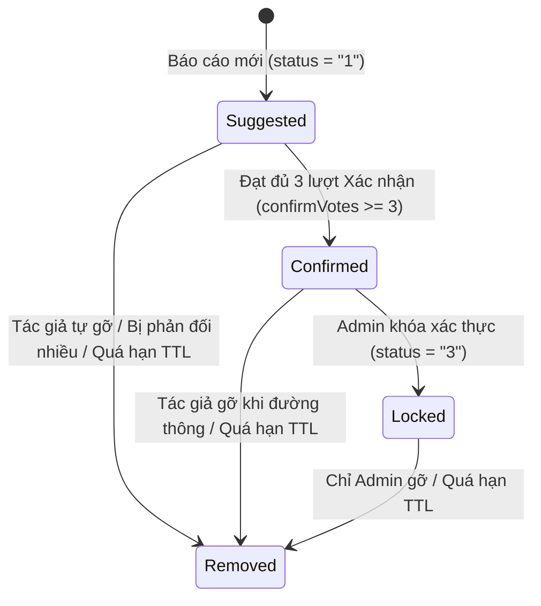

# Giai đoạn 4 (Ngày 7 – Ngày 8): Tìm Kiếm Địa Điểm & Cảnh Báo Giao Thông Cộng Đồng (Hazards)

> **Mục tiêu**: Xây dựng phân hệ Quản lý Địa điểm Lưu trữ (`SavedPlaces`), tích hợp tìm kiếm địa điểm, và phân hệ Cảnh báo Giao thông / Ngập nước theo cơ chế Đồng thuận Cộng đồng 3 Phiếu (`Consensus Voting`), tự động hết hạn (`TTL`), và phòng trò chuyện hiện trường thời gian thực.

---

## 1. Thiết Kế Mô Hình Dữ Liệu (Models & Schemas)

### 1.1 Model Cảnh Báo Giao Thông (`HazardFlag`) — `src/models/hazard_flag.model.js`

```javascript
const { DataTypes } = require("sequelize");
const sequelize = require("../config/postgres.config");

const HazardFlag = sequelize.define(
  "HazardFlag",
  {
    id: {
      type: DataTypes.UUID,
      defaultValue: DataTypes.UUIDV4,
      primaryKey: true,
    },
    userId: {
      type: DataTypes.UUID,
      allowNull: false,
      field: "user_id", // Người tạo báo cáo
    },
    // 3 Loại sự cố: FLOOD (Ngập nước), ACCIDENT (Tai nạn), OBSTRUCTION (Vật cản)
    category: {
      type: DataTypes.ENUM("FLOOD", "ACCIDENT", "OBSTRUCTION"),
      allowNull: false,
      defaultValue: "FLOOD",
    },
    description: {
      type: DataTypes.STRING(500),
      allowNull: true,
    },
    latitude: {
      type: DataTypes.DOUBLE,
      allowNull: false,
    },
    longitude: {
      type: DataTypes.DOUBLE,
      allowNull: false,
    },
    address: {
      type: DataTypes.STRING(255),
      allowNull: true,
    },
    // Bán kính vùng ảnh hưởng: 25m, 50m, 100m, 200m, 250m
    radiusMeters: {
      type: DataTypes.INTEGER,
      defaultValue: 50,
      field: "radius_meters",
      validate: { isIn: [[25, 50, 100, 200, 250]] },
    },
    // Mảng link ảnh hiện trường (tối đa 3 ảnh)
    images: {
      type: DataTypes.ARRAY(DataTypes.STRING),
      defaultValue: [],
    },
    // Trạng thái đồng thuận: "1": SUGGESTED, "2": CONFIRMED, "3": LOCKED, "4": REMOVED
    status: {
      type: DataTypes.ENUM("1", "2", "3", "4"),
      defaultValue: "1",
      allowNull: false,
    },
    confirmVotes: {
      type: DataTypes.INTEGER,
      defaultValue: 0,
      field: "confirm_votes",
    },
    denyVotes: {
      type: DataTypes.INTEGER,
      defaultValue: 0,
      field: "deny_votes",
    },
    // Thời hạn tồn tại (TTL): 1h, 2h, 4h, 12h, 24h
    ttlMinutes: {
      type: DataTypes.INTEGER,
      defaultValue: 120, // 2 giờ mặc định
      field: "ttl_minutes",
      validate: { isIn: [[60, 120, 240, 720, 1440]] },
    },
    expiresAt: {
      type: DataTypes.DATE,
      allowNull: false,
      field: "expires_at",
    },
  },
  {
    tableName: "hazard_flags",
    timestamps: true,
    indexes: [
      { fields: ["status", "expires_at"] },
      { fields: ["latitude", "longitude"] },
    ],
  }
);

module.exports = HazardFlag;
```

### 1.2 Model Lịch Sử Bình Chọn (`HazardVote`) & Địa Điểm Đã Lưu (`SavedPlace`)
- **`HazardVote`**: Lưu lượt bình chọn của người dùng (`userId`, `flagId`, `voteType`: `'CONFIRM'` hoặc `'DENY'`) để đảm bảo mỗi tài khoản chỉ bình chọn 1 lần trên mỗi sự cố.
- **`SavedPlace`**: Lưu các địa điểm ưa thích của người dùng (`userId`, `name`, `latitude`, `longitude`, `address`, `category`: `'HOME'`, `'WORK'`, `'OTHER'`).
- **`SavedRoute`**: Lưu lộ trình thường đi của người dùng kèm hình học tuyến (GeoJSON) để tải lại nhanh mà không cần tốn lượt giải đường mới.

---

## 2. Quy Tắc Đồng Thuận Cộng Đồng (Consensus Voting Engine)



### 2.1 Quy Tắc Phân Quyền Bình Chọn & Gỡ Bỏ
1. **Đối với báo cáo Đề xuất (`status = "1"` / `SUGGESTED`)**:
   - **Tác giả tạo báo cáo**: Chỉ có quyền bấm **Gỡ (`unflag`)**, tuyệt đối **không được tự bình chọn** xác nhận cho báo cáo của chính mình.
   - **Người dùng khác**: Có quyền bấm **Xác nhận (`confirm`)** hoặc **Phản đối (`deny`)**.
   - Khi số lượt xác nhận đạt đủ ngưỡng **`FLAG_CONSENSUS_THRESHOLD = 3`**:
     - Báo cáo tự động thăng cấp lên **`status = "2"` (`CONFIRMED`)**.
     - Cộng điểm uy tín (`reputationPoints`) cho tác giả ban đầu.
     - Kích hoạt thuật toán định tuyến Valhalla tự động tìm đường né tránh vùng này.
   - Nếu số lượt phản đối vượt quá số xác nhận (`denyVotes >= 3 && denyVotes > confirmVotes`): Báo cáo tự động chuyển sang `status = "4"` (`REMOVED`).
2. **Đối với báo cáo Đã xác nhận (`status = "2"` / `CONFIRMED`)**:
   - Đóng cổng bình chọn.
   - Tác giả ban đầu vẫn được quyền bấm **Gỡ** khi thấy đường đã rút nước hoặc thông xe.
3. **Đối với báo cáo Đã khóa (`status = "3"` / `LOCKED`)**:
   - Do Quản trị viên (`Admin`) thẩm định và khóa cứng.
   - Ngay cả tác giả ban đầu cũng **không thể gỡ**. Chỉ có Admin mới được mở khóa hoặc xóa.
4. **Tự động hết hạn (TTL Cron Job)**:
   - Một background cron job chạy định kỳ mỗi **5 phút** quét các bản ghi có `expiresAt <= NOW()` và `status != '4'` để chuyển trạng thái sang `REMOVED`.

---

## 3. Đặc Tả Danh Sách Endpoints (API Contracts)

### 3.1 Phân hệ Cảnh Báo Sự Cố Giao Thông (`/api/v1/flags`)
| Method | Endpoint | Mô Tả Nghiệp Vụ | Phân Quyền |
|---|---|---|---|
| `POST` | `/api/v1/flags` | Báo cáo sự cố mới (`category`, `lat`, `lng`, `radiusMeters`, `ttlMinutes`, tối đa 3 ảnh) | Cookie `road_as_token` |
| `GET` | `/api/v1/flags/nearby` | Lấy danh sách sự cố còn hiệu lực trong bán kính 2 km quanh tọa độ gửi lên | Cookie `road_as_token` / Public |
| `GET` | `/api/v1/flags/my` | Lấy danh sách các sự cố do chính người dùng hiện tại đã báo cáo | Cookie `road_as_token` |
| `GET` | `/api/v1/flags/:id` | Xem chi tiết sự cố, số phiếu xác nhận, bình luận và ảnh hiện trường | Cookie `road_as_token` / Public |
| `POST` | `/api/v1/flags/:id/vote` | Bình chọn Xác nhận (`CONFIRM`) hoặc Phản đối (`DENY`). Chặn tự vote | Cookie `road_as_token` |
| `POST` | `/api/v1/flags/:id/unflag` | Tác giả tự gỡ bỏ sự cố khi đường đã thông thoáng | Tác giả báo cáo |
| `PUT` | `/api/v1/admin/flags/:id/lock` | Quản trị viên khóa xác thực sự cố (`status = "3"`) | Admin (`role=admin`) |
| `DELETE` | `/api/v1/admin/flags/:id` | Quản trị viên xóa sự cố giả mạo / spam | Admin (`role=admin`) |

### 3.2 Phân hệ Địa Điểm & Lộ Trình Đã Lưu (`/api/v1/places`)
| Method | Endpoint | Mô Tả Nghiệp Vụ | Phân Quyền |
|---|---|---|---|
| `GET` | `/api/v1/places/saved` | Lấy danh sách địa điểm đã lưu của người dùng (Nhà, Công ty...) | Cookie `road_as_token` |
| `POST` | `/api/v1/places/saved` | Lưu một địa điểm mới (`name`, `latitude`, `longitude`, `address`, `category`) | Cookie `road_as_token` |
| `DELETE` | `/api/v1/places/saved/:id` | Xóa địa điểm đã lưu | Cookie `road_as_token` |
| `GET` | `/api/v1/places/routes` | Lấy danh sách các lộ trình đã lưu kèm GeoJSON | Cookie `road_as_token` |
| `POST` | `/api/v1/places/routes` | Lưu lộ trình thường đi (tên tối đa 120 ký tự, mảng điểm dừng) | Cookie `road_as_token` |

---

## 4. Kế Hoạch Push Commit Chi Tiết

### Đợt 7 (Ngày 7) — `feat(places-hazards)`: Quản lý Địa điểm & Tạo Báo cáo Sự cố Hiện trường
- **Mục tiêu**: Xây dựng Model `SavedPlace`, `HazardFlag`, API lưu địa điểm và API gửi báo cáo sự cố (tính toán `expiresAt` theo `ttlMinutes`, upload tối đa 3 ảnh).
- **Các bước thực hiện**:
  1. Tạo `src/models/saved_place.model.js` và `src/models/hazard_flag.model.js`.
  2. Viết `src/services/place.service.js` xử lý CRUD địa điểm đã lưu và lộ trình yêu thích.
  3. Viết `src/services/flag.service.js` tiếp nhận báo cáo sự cố, kiểm tra tham số bán kính và TTL.
  4. Cấu hình upload ảnh hiện trường qua middleware `src/middlewares/upload.middleware.js` (nén ảnh <= 800KB).
- **Git Commit Message**:
  ```text
  feat(places-hazards): implement saved places apis, hazard flag reporting and image attachment handler
  ```

### Đợt 8 (Ngày 8) — `feat(consensus)`: Cơ chế Đồng thuận 3 Phiếu, TTL Cron & Admin Khóa Sự cố
- **Mục tiêu**: Hoàn thiện logic kiểm tra quyền bình chọn, tự động thăng cấp `Confirmed` khi đủ 3 phiếu, background cron dọn dẹp Flag hết hạn và quyền Admin Lock.
- **Các bước thực hiện**:
  1. Tạo `src/models/hazard_vote.model.js` với ràng buộc unique `(user_id, flag_id)`.
  2. Triển khai phương thức `voteFlag({ userId, flagId, voteType })` trong `flag.service.js` với transaction an toàn.
  3. Xây dựng cron job `src/jobs/cron/flag_ttl.job.js` quét Flag hết hạn mỗi 5 phút.
  4. Viết endpoints cho Admin (`/api/v1/admin/flags/:id/lock`) và kiểm tra API truy vấn lân cận 2km (`/api/v1/flags/nearby`).
- **Git Commit Message**:
  ```text
  feat(consensus): implement 3-vote consensus engine, ttl auto-expiry cron job and admin flag lock apis
  ```

