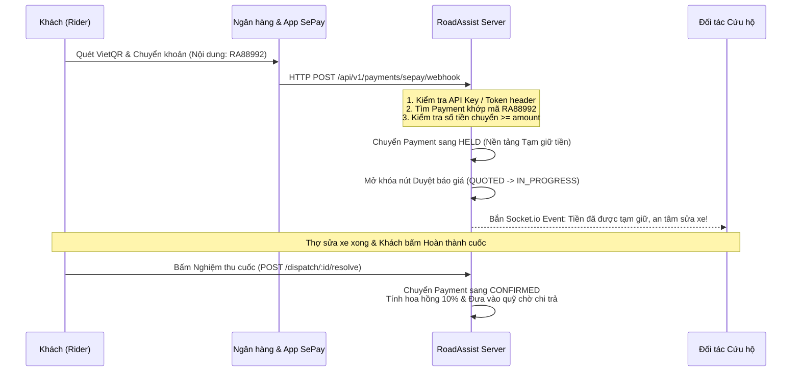

# Giai đoạn 6 (Ngày 12 – Ngày 13): Hóa Đơn Hành Trình, Tích Hợp SePay, Tạm Giữ Escrow & Đối Soát

> **Mục tiêu**: Xây dựng phân hệ Hóa đơn Hành trình (`Journey Bill`), tích hợp cổng thanh toán tự động **SePay** (VietQR & Webhook), cơ chế Tạm giữ tiền bảo vệ khách hàng (**Escrow / `HELD`**), thanh toán tiền mặt có đối tác xác nhận, khấu trừ hoa hồng nền tảng, và hệ thống đối soát chi trả theo lô (`PayoutBatch`).

---

## 1. Thiết Kế Mô Hình Dữ Liệu (Models & Schemas)

### 1.1 Model Hóa Đơn & Thanh Toán (`Bill`, `BillItem`, `BillPayment`) — `src/models/bill.model.js`

```javascript
const { DataTypes } = require("sequelize");
const sequelize = require("../config/postgres.config");

// 1. Hóa đơn tổng gom theo hành trình sự cố (journeyId)
const Bill = sequelize.define(
  "Bill",
  {
    id: {
      type: DataTypes.UUID,
      defaultValue: DataTypes.UUIDV4,
      primaryKey: true,
    },
    code: {
      type: DataTypes.STRING(20),
      allowNull: false,
      unique: true, // Mã hóa đơn: RAB-2026-0001
    },
    journeyId: {
      type: DataTypes.UUID,
      allowNull: false,
      field: "journey_id",
    },
    userId: {
      type: DataTypes.UUID,
      allowNull: false,
      field: "user_id", // Người trả tiền (Rider)
    },
    totalAmount: {
      type: DataTypes.DECIMAL(12, 2),
      defaultValue: 0,
      field: "total_amount",
    },
    paidAmount: {
      type: DataTypes.DECIMAL(12, 2),
      defaultValue: 0,
      field: "paid_amount",
    },
    dueAmount: {
      type: DataTypes.DECIMAL(12, 2),
      defaultValue: 0,
      field: "due_amount",
    },
    status: {
      type: DataTypes.ENUM("DRAFT", "PENDING", "PARTIAL", "PAID", "VOID"),
      defaultValue: "PENDING",
      allowNull: false,
    },
  },
  { tableName: "bills", timestamps: true }
);

// 2. Chi tiết từng hạng mục trong hóa đơn (Phí SOS, Cước kéo xe, Phí sửa chữa)
const BillItem = sequelize.define(
  "BillItem",
  {
    id: {
      type: DataTypes.UUID,
      defaultValue: DataTypes.UUIDV4,
      primaryKey: true,
    },
    billId: {
      type: DataTypes.UUID,
      allowNull: false,
      field: "bill_id",
    },
    ticketId: {
      type: DataTypes.UUID,
      allowNull: false,
      field: "ticket_id",
    },
    type: {
      type: DataTypes.ENUM("SOS_CALLOUT", "TOW_FARE", "WAITING_FEE", "SHOP_REPAIR"),
      allowNull: false,
    },
    title: {
      type: DataTypes.STRING(150),
      allowNull: false,
    },
    amount: {
      type: DataTypes.DECIMAL(12, 2),
      allowNull: false,
    },
  },
  { tableName: "bill_items", timestamps: true }
);

// 3. Bản ghi giao dịch thanh toán (SePay QR hoặc Tiền mặt)
const BillPayment = sequelize.define(
  "BillPayment",
  {
    id: {
      type: DataTypes.UUID,
      defaultValue: DataTypes.UUIDV4,
      primaryKey: true,
    },
    billId: {
      type: DataTypes.UUID,
      allowNull: false,
      field: "bill_id",
    },
    billItemId: {
      type: DataTypes.UUID,
      allowNull: true,
      field: "bill_item_id",
    },
    providerId: {
      type: DataTypes.UUID,
      allowNull: false,
      field: "provider_id", // Đối tác thụ hưởng sau khấu trừ
    },
    amount: {
      type: DataTypes.DECIMAL(12, 2),
      allowNull: false,
    },
    method: {
      type: DataTypes.ENUM("SEPAY", "CASH"),
      allowNull: false,
    },
    // Vòng đời trạng thái: PENDING -> HELD (Tạm giữ) -> CONFIRMED (Đã quyết toán) -> REFUNDED
    status: {
      type: DataTypes.ENUM("PENDING", "HELD", "CONFIRMED", "REFUNDED"),
      defaultValue: "PENDING",
      allowNull: false,
    },
    transactionCode: {
      type: DataTypes.STRING(50),
      allowNull: false,
      unique: true, // Mã giao dịch SePay: RA_PAY_12345
      field: "transaction_code",
    },
    sepayReference: {
      type: DataTypes.STRING(100),
      allowNull: true,
      field: "sepay_reference", // Mã tham chiếu của SePay / Ngân hàng
    },
    commissionRate: {
      type: DataTypes.FLOAT,
      defaultValue: 0.10, // 10% hoa hồng nền tảng mặc định
      field: "commission_rate",
    },
    commissionAmount: {
      type: DataTypes.DECIMAL(12, 2),
      defaultValue: 0,
      field: "commission_amount",
    },
    payoutAmount: {
      type: DataTypes.DECIMAL(12, 2),
      defaultValue: 0,
      field: "payout_amount", // Số tiền thực nhận = amount - commissionAmount
    },
    payoutBatchId: {
      type: DataTypes.UUID,
      allowNull: true,
      field: "payout_batch_id", // Gắn vào đợt giải ngân của Admin
    },
    paidAt: {
      type: DataTypes.DATE,
      allowNull: true,
      field: "paid_at",
    },
  },
  { tableName: "bill_payments", timestamps: true }
);

module.exports = { Bill, BillItem, BillPayment };
```

---

## 2. Tích Hợp Cổng Thanh Toán SePay & Cơ Chế Escrow

### 2.1 Tạo Mã Chuyển Khoản & VietQR
Khi Rider chọn thanh toán một hạng mục hoặc toàn bộ hóa đơn qua SePay:
1. Hệ thống tạo bản ghi `BillPayment` với `method = "SEPAY"`, `status = "PENDING"`, và mã giao dịch duy nhất dạng: `RA<paymentShortId>` (ví dụ: `RA88992`).
2. Trả về cho ứng dụng di động thông tin thanh toán:
   - Tên ngân hàng (`SEPAY_BANK_CODE`, ví dụ: `MBBank`).
   - Số tài khoản (`SEPAY_ACCOUNT_NUMBER`).
   - Tên chủ tài khoản.
   - Số tiền cần chuyển chính xác.
   - Nội dung chuyển khoản bắt buộc: `RA88992`.
   - Link ảnh VietQR chuẩn Napas 247 được sinh trực tiếp hoặc mở trang thanh toán QuickPay của SePay.

### 2.2 Xử Lý Webhook Từ SePay (`POST /api/v1/payments/sepay/webhook`)
Tài liệu SePay Developer: https://developer.sepay.vn/



### Chi tiết Webhook Payload từ SePay:
```json
{
  "id": 123456,
  "gateway": "MBBank",
  "transactionDate": "2026-10-30 14:20:00",
  "accountNumber": "0123456789",
  "code": null,
  "content": "RA88992 CHUYEN TIEN CUU HO",
  "transferType": "in",
  "transferAmount": 350000,
  "accumulated": 15000000,
  "referenceCode": "FT263048899201",
  "description": "SePay nhận tiền thành công"
}
```

- **Quy trình xác thực an toàn**:
  - Kiểm tra Header: `Authorization: Apikey <SEPAY_WEBHOOK_TOKEN>` hoặc `X-Secret-Key`.
  - Trích xuất mã giao dịch từ `content` bằng Regex: `/RA\d+/`.
  - Sử dụng **Database Transaction** (`sequelize.transaction`) và khóa hàng cập nhật (`lock: UPDATE`) để chống trường hợp Webhook gửi lặp (idempotency check).
  - Cập nhật số tiền đã thu trên hóa đơn `Bill`.

---

## 3. Luồng Thanh Toán Tiền Mặt (`CASH`) & Quyết Toán Theo Lô (`PayoutBatch`)

### 3.1 Thanh Toán Tiền Mặt
- Nếu khách chọn "Tiền mặt", hệ thống tạo `BillPayment` với `status = "PENDING"`.
- Nút Duyệt báo giá trên ứng dụng vẫn được mở khóa tạm thời để không làm gián đoạn cứu hộ.
- Khi bàn giao xe, khách trả tiền mặt trực tiếp cho thợ/tài xế xe kéo.
- Đối tác bắt buộc mở app bấm **"Xác nhận đã nhận tiền mặt"** (`POST /api/v1/payments/confirm-cash`):
  - Hệ thống chuyển `status` sang `CONFIRMED`.
  - Khoản hoa hồng nền tảng (10%) được ghi nhận là nợ hoa hồng của đối tác để cấn trừ vào các khoản thanh toán online trong đợt đối soát tiếp theo.

### 3.2 Đối Soát & Chi Trả Cho Đối Tác Theo Lô (`PayoutBatch`)
- Ứng dụng **không cung cấp nút rút tiền thủ công tùy tiện**.
- Định kỳ hàng tuần hoặc theo chu kỳ của công ty, Quản trị viên (`Admin`) chạy tiến trình kết toán đợt chi trả:
  1. `POST /api/v1/admin/payouts/create-batch`: Quét toàn bộ các khoản thu `CONFIRMED` chưa được gán lô (`payoutBatchId IS NULL`).
  2. Tính tổng doanh thu gộp (`gross`), hoa hồng khấu trừ (`commission`), và số tiền thực nhận ròng (`net`).
  3. `PUT /api/v1/admin/payouts/:id/settle`: Đánh dấu đã giải ngân qua chuyển khoản ngân hàng lô, đồng thời bắn thông báo Socket.io / Push `PAYOUT_SETTLED` cho từng đối tác.

---

## 4. Đặc Tả Danh Sách Endpoints (API Contracts)

### 4.1 Phân hệ Hóa Đơn & Thanh Toán (`/api/v1/payments`)
| Method | Endpoint | Mô Tả Nghiệp Vụ | Phân Quyền |
|---|---|---|---|
| `GET` | `/api/v1/bills/my-bills` | Lấy danh sách hóa đơn theo góc nhìn Rider (đếm số hóa đơn chưa trả) | Bearer Token |
| `GET` | `/api/v1/bills/:id` | Xem chi tiết hóa đơn hành trình và các hạng mục chi phí | Owner Rider |
| `POST` | `/api/v1/payments/create-sepay-qr` | Sinh mã thanh toán QR SePay cho hóa đơn / hạng mục | Owner Rider |
| `POST` | `/api/v1/payments/sepay/webhook` | Webhook tiếp nhận biến động số dư từ SePay, kích hoạt Escrow | Public (SePay Key) |
| `POST` | `/api/v1/payments/choose-cash` | Chọn phương thức thanh toán tiền mặt | Owner Rider |
| `POST` | `/api/v1/payments/confirm-cash` | Đối tác xác nhận đã nhận đủ tiền mặt từ khách tại hiện trường | Assigned Provider |
| `GET` | `/api/v1/payments/provider-earnings`| Đối tác xem tổng kết doanh thu, tiền chờ nhận và lịch sử chi trả | Provider |

### 4.2 Phân hệ Quản Trị Đối Soát (`/api/v1/admin/payouts`)
| Method | Endpoint | Mô Tả Nghiệp Vụ | Phân Quyền |
|---|---|---|---|
| `GET` | `/api/v1/admin/payouts/pending-items` | Xem danh sách các khoản thu hợp lệ đang chờ đối soát | Admin (`role=admin`) |
| `POST` | `/api/v1/admin/payouts/create-batch` | Gom các khoản thu hợp lệ tạo đợt chi trả mới (`PayoutBatch`) | Admin (`role=admin`) |
| `GET` | `/api/v1/admin/payouts/batches` | Lấy lịch sử các đợt chi trả hoa hồng | Admin (`role=admin`) |
| `PUT` | `/api/v1/admin/payouts/:id/settle` | Xác nhận đã hoàn tất chuyển tiền cho đối tác và gửi thông báo | Admin (`role=admin`) |

---

## 5. Kế Hoạch Push Commit Chi Tiết

### Đợt 12 (Ngày 12) — `feat(bills)`: Gom Hóa Đơn Hành Trình, Thanh Toán Tiền Mặt & Khấu Trừ Hoa Hồng
- **Mục tiêu**: Xây dựng Model `Bill`, `BillItem`, `BillPayment`, API gom các dịch vụ trong cùng `journeyId` thành 1 hóa đơn, luồng chọn tiền mặt và đối tác xác nhận tiền mặt.
- **Các bước thực hiện**:
  1. Tạo các model hóa đơn và thanh toán trong `src/models/bill.model.js`.
  2. Viết `src/services/bill.service.js` tự động gom chi phí khi các phiếu cứu hộ phát sinh chi phí hoặc báo giá.
  3. Viết API chọn tiền mặt và API `confirm-cash` cho đối tác.
  4. Triển khai công thức tính hoa hồng nền tảng (`commissionRate = 0.10`).
- **Git Commit Message**:
  ```text
  feat(bills): implement journey bill aggregation, cash payment flow and platform commission calculation
  ```

### Đợt 13 (Ngày 13) — `feat(sepay-escrow)`: Tích Hợp SePay QR, Webhook Handler & Cơ Chế Escrow
- **Mục tiêu**: Tích hợp cổng thanh toán SePay, sinh VietQR động, viết Webhook idempotent xử lý tiền về, chuyển tiền sang trạng thái `HELD` và chốt `CONFIRMED` khi hoàn thành cuốc.
- **Các bước thực hiện**:
  1. Viết `src/services/sepay.service.js` sinh mã QR QuickPay và tra cứu giao dịch.
  2. Xây dựng webhook controller `POST /payments/sepay/webhook` có xác thực token và regex trích xuất mã giao dịch.
  3. Bọc cập nhật trạng thái `HELD` trong transaction, mở khóa trạng thái phiếu cứu hộ sang `IN_PROGRESS`.
  4. Xây dựng phân hệ đối soát theo lô `PayoutBatch` cho Quản trị viên.
- **Git Commit Message**:
  ```text
  feat(sepay-escrow): integrate sepay qr generation, webhook handler, escrow fund locking and admin payout batches
  ```

