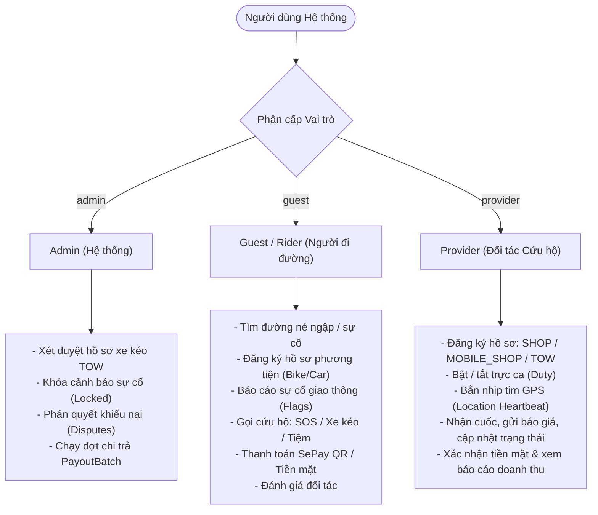

# Lộ trình Phát triển Backend RoadAssist Server (2 Tuần Sprint)

> **Dự án**: RoadAssist Server — Nền tảng Điều phối Cứu hộ Giao thông & Định tuyến Thông minh Đa phương thức  
> **Kiến trúc**: Node.js (Express, Sequelize ORM, PostgreSQL, Redis, BullMQ, SePay, Socket.io)  
> **Tiêu chuẩn Nền tảng**: **100% Vận hành trên Nền tảng Web (Web Platform / Web Application)** cho cả 3 đối tượng (Admin, Rider, Provider) — **Hoàn toàn KHÔNG chạy trên mobile native**.  
> **Tiêu chuẩn Dữ liệu**: **100% sử dụng PostgreSQL qua Sequelize ORM (`src/config/postgres.config.js`)** cho toàn bộ dữ liệu (Users, Auth, Vehicles, Providers, Flags, Dispatch, Chat, Bills, Payments). **Tuyệt đối KHÔNG sử dụng Firebase (không Firebase Auth, không Firestore)**.  
> **Mục tiêu**: Tách độc lập khỏi Picare Core, loại bỏ hoàn toàn gRPC, kế thừa và chuẩn hóa cấu trúc Module/Layered từ WMS, tích hợp xác thực Auth (3 Roles) từ Picare Core, và hệ thống thanh toán Tạm giữ (Escrow) qua SePay QR & Tiền mặt.  
> **Thời gian thực hiện**: 14 Ngày (2 Tuần làm việc) — Phân bổ theo từng đợt Commit/Push rõ ràng.

---

## 1. Bản đồ Tài liệu Lộ trình (Roadmap Sitemap)

Thư mục `docs/roadmap/` được chia thành các tài liệu chi tiết cho từng giai đoạn:

| STT | File Tài Liệu | Nội Dung Cốt Lõi | Ngày Thực Hiện | Số Lượng Commit |
|:---:|---|---|:---:|:---:|
| 01 | [01_PHASE_1_SETUP_AND_CLEANUP.md](./01_PHASE_1_SETUP_AND_CLEANUP.md) | Dọn dẹp WMS, gỡ gRPC, giữ khung kiến trúc, cấu hình môi trường & `index.js` | Ngày 1 – 2 | 2 Đợt Commit |
| 02 | [02_PHASE_2_AUTH_USER_AND_VEHICLES.md](./02_PHASE_2_AUTH_USER_AND_VEHICLES.md) | Clone Auth Picare Core, 3 Roles (`admin`, `guest`, `provider`), JWT Session & Quản lý Phương tiện | Ngày 3 – 4 | 2 Đợt Commit |
| 03 | [03_PHASE_3_PROVIDERS_AND_DUTY.md](./03_PHASE_3_PROVIDERS_AND_DUTY.md) | Hồ sơ Đối tác (`SHOP`, `MOBILE_SHOP`, `TOW`), Xét duyệt Admin, GPS Heartbeat & Trực ca | Ngày 5 – 6 | 2 Đợt Commit |
| 04 | [04_PHASE_4_PLACES_AND_HAZARD_FLAGS.md](./04_PHASE_4_PLACES_AND_HAZARD_FLAGS.md) | Cảnh báo Sự cố Ngập/Tai nạn Cộng đồng, Đồng thuận 3 phiếu, TTL, Lưu & Tìm kiếm Địa điểm | Ngày 7 – 8 | 2 Đợt Commit |
| 05 | [05_PHASE_5_DISPATCH_AND_ASSIST.md](./05_PHASE_5_DISPATCH_AND_ASSIST.md) | Điều phối Cứu hộ Đa phương thức: Walk-in Tiệm, SOS Lưu động, Xe kéo TOW (15 Trạng thái) | Ngày 9 – 11 | 3 Đợt Commit |
| 06 | [06_PHASE_6_BILLS_SEPAY_AND_ESCROW.md](./06_PHASE_6_BILLS_SEPAY_AND_ESCROW.md) | Hóa đơn Hành trình, Tích hợp SePay Webhook, Cơ chế Tạm giữ Escrow, Tiền mặt & Quyết toán | Ngày 12 – 13 | 2 Đợt Commit |
| 07 | [07_PHASE_7_CHAT_RATINGS_DISPUTES_AND_TESTING.md](./07_PHASE_7_CHAT_RATINGS_DISPUTES_AND_TESTING.md) | Chat theo phiên bản, Đánh giá 2 chiều, Khiếu nại 7 ngày, Swagger & Kiểm thử Tích hợp | Ngày 14 | 1 Đợt Commit |

---

## 2. Ma trận Vai trò (3 Roles) & Phân quyền Hệ thống

Hệ thống hoạt động với **3 Roles chính** trên bảng `users`:



### Chi tiết 3 Roles:
1. **`admin` (Quản trị viên Hệ thống)**:
   - Toàn quyền cấu hình bảng giá, duyệt xe cứu hộ `TOW`, khóa cảnh báo giao thông nghiêm trọng (`status = 3`), xử lý khiếu nại (`Disputes`), và thực hiện giải ngân theo lô (`PayoutBatch`).
   - Được tạo sẵn thông qua migration / seed ban đầu.
2. **`guest` (hay `rider` - Người đi đường / Khách hàng)**:
   - Vai trò mặc định khi đăng ký trên nền tảng Web (`POST /api/v1/auth/register`).
   - Được gắn quyền dịch vụ `"RIDER"` trong mảng `services`.
   - Có thể sở hữu nhiều phương tiện (`BIKE`, `CAR`) và chọn 1 xe làm `activeVehicle`.
   - Được phép nâng cấp đăng ký thêm hồ sơ đối tác để trở thành `provider`.
3. **`provider` (Đối tác Cứu hộ)**:
   - Người dùng đăng ký hồ sơ đối tác thông qua Onboarding hoặc màn hình Dịch vụ đối tác.
   - Có 3 phân loại đơn vị:
     - `SHOP`: Tiệm sửa xe cố định (không gắn xe, duyệt tự động khi đăng ký).
     - `MOBILE_SHOP`: Thợ cơ động SOS (gắn với xe máy hoặc ô tô, duyệt tự động).
     - `TOW`: Tài xế xe kéo cứu hộ (bắt buộc gắn với xe ô tô `CAR`, biển số chuẩn VN, **bắt buộc phải qua Admin xét duyệt**).

---

## 3. Quy chuẩn Git Commit & Quy trình Push Đợt

Dự án hiện chưa khởi tạo Git (`git init`). Khi dev bắt đầu thực hiện code theo từng Phase, **phải tuân thủ nghiêm ngặt quy tắc commit sau đây**:

### 3.1 Cú pháp Commit (Conventional Commits)
```text
<type>(<scope>): <mô tả ngắn gọn bằng tiếng Anh hoặc tiếng Việt không dấu>

[optional body: mô tả chi tiết các file thay đổi, logic xử lý]

[optional footer: Task ID hoặc Ref issue]
```

- **`type`** bắt buộc:
  - `feat`: Thêm tính năng mới (APIs, Model, Service).
  - `fix`: Sửa lỗi logic, sửa bug validation hoặc runtime.
  - `refactor`: Tái cấu trúc code (xóa bỏ WMS cũ, tối ưu query).
  - `chore`: Cấu hình môi trường, dependencies, scripts, build.
  - `docs`: Thêm hoặc cập nhật tài liệu API, roadmap.
- **`scope`**: `setup`, `auth`, `user`, `vehicle`, `provider`, `duty`, `hazard`, `place`, `dispatch`, `bill`, `payment`, `sepay`, `chat`, `rating`, `dispute`, `test`.

### 3.2 Lịch trình Push Commit 14 Đợt (Mỗi ngày 1 Đợt)

```text
Tuần 1:
├── Ngày 01 (Commit #01) [chore(setup)]: initialize standalone server structure and prune wms modules
├── Ngày 02 (Commit #02) [feat(core)]: setup postgres, redis, base exceptions, response handler and clean index.js
├── Ngày 03 (Commit #03) [feat(auth)]: implement auth models, jwt session, rate limiter and mail service
├── Ngày 04 (Commit #04) [feat(user-vehicle)]: add user registration, profile onboarding and vehicle profile apis
├── Ngày 05 (Commit #05) [feat(provider)]: implement provider models and registration for shop, mobile and tow
├── Ngày 06 (Commit #06) [feat(duty)]: add location heartbeat tracking and duty status toggle for providers
└── Ngày 07 (Commit #07) [feat(places-hazards)]: implement place search, saved places and hazard reporting apis

Tuần 2:
├── Ngày 08 (Commit #08) [feat(consensus)]: implement hazard consensus voting, auto expiry and ttl cron
├── Ngày 09 (Commit #09) [feat(dispatch-walkin)]: implement walk-in shop dispatch flow and arrival check-in
├── Ngày 10 (Commit #10) [feat(dispatch-sos)]: implement mobile shop sos emergency dispatch, unfixable and handoff
├── Ngày 11 (Commit #11) [feat(dispatch-tow)]: implement tow dispatch, 15km broadcast, waiting timer and auto retarget
├── Ngày 12 (Commit #12) [feat(bills)]: implement journey bill aggregation, cash payment and provider commission
├── Ngày 13 (Commit #13) [feat(sepay-escrow)]: integrate sepay qr generation, webhook handler and escrow fund lock
└── Ngày 14 (Commit #14) [feat(chat-dispute-test)]: implement versioned chat, 2-way ratings, disputes and swagger docs
```

---

## 4. Bảng Tra cứu Mã 15 Trạng thái Cứu hộ (`DISPATCH_STATUS`)

| Mã | Hằng số | Nhãn Tiếng Việt | Kết thúc (`isTerminal`) | Mô tả Nghiệp vụ |
|:---:|---|---|:---:|---|
| `"1"` | `PENDING` | Đang chờ | Không | Mới phát sóng trong bán kính 15 km, chờ đối tác nhận |
| `"2"` | `MATCHED` | Đã nhận | Không | Đối tác đã nhận cuốc; đang di chuyển tới điểm đón |
| `"3"` | `ARRIVED` | Đã đến | Không | Khách hoặc đối tác xác nhận đã tới điểm đón (`<= 200m`) |
| `"4"` | `RESOLVED` | Hoàn thành | **Có** | Khách nghiệm thu, cuốc kết thúc thành công |
| `"5"` | `CANCELLED` | Đã hủy | **Có** | Cuốc bị hủy bởi các bên theo phân quyền |
| `"6"` | `IN_PROGRESS`| Đang sửa | Không | Khách đã đảm bảo thanh toán (SePay/Cash) & duyệt báo giá |
| `"7"` | `READY` | Xong chờ lấy | Không | Thợ/tiệm đã sửa xong, chờ khách kiểm tra bàn giao |
| `"8"` | `DECLINED` | Từ chối | **Có** | Tiệm từ chối yêu cầu Walk-in |
| `"9"` | `QUOTED` | Đã báo giá | Không | Tiệm/thợ gửi báo giá chính thức ràng buộc 1 lần duy nhất |
| `"10"`| `IN_SHOP` | Tại tiệm | Không | Xe đã vào bàn nâng để kiểm tra kỹ thuật |
| `"11"`| `FINAL_QUOTED`| Báo giá cuối | Không | Báo giá chốt phát sinh (tương thích) |
| `"12"`| `RESOLVED_UNFIXABLE`| Đóng không sửa được | **Có** | Kết thúc hồ sơ trường hợp bất khả kháng |
| `"13"`| `ESTIMATED` | Báo giá sơ bộ | Không | Tiệm đích gửi ước tính chi phí trước khi xe kéo tới |
| `"14"`| `EST_APPROVED`| Duyệt giá sơ bộ | Không | Khách đồng ý với ước tính sơ bộ của tiệm đích |
| `"15"`| `UNFIXABLE` | Không sửa được | **Có** | Thợ xác nhận không sửa được tại chỗ + ảnh bằng chứng |

---

## 5. Nguyên tắc Triển khai Kỹ thuật Chung

1. **Kiến trúc Layered MVC rõ ràng**:
   - `models/`: Định nghĩa thực thể Sequelize, quan hệ khóa ngoại, index và hooks.
   - `schemas/`: Kiểm tra dữ liệu đầu vào (express-validator / Joi) và DTO chuẩn hóa response.
   - `controllers/`: Tiếp nhận request, gọi service, trả về response qua `ResponseHandler`.
   - `services/`: Chứa 100% logic nghiệp vụ, transaction database, tính toán tiền bạc và bắn event.
   - `routes/`: Khai báo endpoint, gắn middleware xác thực và validator schema.
2. **Xử lý Ngoại lệ Tập trung**:
   - Mọi lỗi nghiệp vụ đều ném qua các exception kế thừa từ `BaseException` (`BadRequestException`, `UnauthorizedException`, `ForbiddenException`, `NotFoundException`, `ConflictException`).
   - `globalErrorHandler` trong `src/middlewares/error.handler.js` chịu trách nhiệm format mã lỗi và message đồng nhất.
3. **An toàn Giao dịch Tài chính & Escrow**:
   - Mọi thao tác đổi trạng thái thanh toán hoặc hoàn thành phiếu cứu hộ đều phải bọc trong **Database Transaction** (`sequelize.transaction()`).
   - Khóa bản ghi khi cập nhật (`transaction.LOCK.UPDATE`) để triệt tiêu race condition (hai đối tác nhận cùng 1 cuốc, hoặc webhook SePay bắn lặp).

